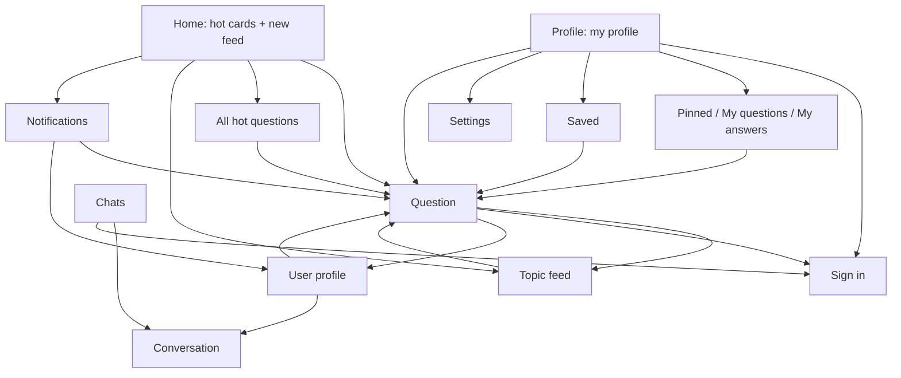

# SPEC-02: Design

*Applies [DESIGN-PHILOSOPHY.md](DESIGN-PHILOSOPHY.md). Vocabulary mapping: **item** = question · **artwork** = the question's cover (or a monogram) · **hero screen** = the question screen · **now surface** = none in v0.1 (a reply in progress may become one later).*

## 1. Principles for this app

1. **Reading first.** Text is the content. Generous line height, comfortable margins, nothing competes with the question.
2. **One tap to the question.** Rows open the question; secondary actions sit in the top bar.
3. **The site stays one tap away.** "Open on Stips" everywhere content appears; we're a better window, not a replacement.
4. **Calm chrome, colorful content.** Channels bring their own colors; the rest follows the wallpaper.

## 2. Design system

| Token | Value |
|---|---|
| Color | Dynamic color (Android 12+). Fallback seed: Stips green `#09C286`. Accent presets: `#09C286` (default) + the 8 presets of DESIGN-PHILOSOPHY Appendix A |
| Scheme generator | DESIGN-PHILOSOPHY §2.2 in CIELAB (`ui/theme/SchemeGenerator.kt`), tone table from Appendix A |
| Channel tint | A question in a channel uses a scheme generated from the channel's first gradient color |
| Pure black | Dark mode option; surfaces from Appendix A |
| Type | Roboto (platform), M3 type scale; Hebrew falls back to the platform's Hebrew font |
| Shapes | Search pill 28 dp · cards 20 dp · grouped settings 24/4 dp, 2 dp gaps · covers: squircle, 28% corners |
| Spacing | 4 dp grid; 16 dp screen margins |
| Icons | Material Symbols (outlined; filled = selected), from the Compose icon set |

## 3. Information architecture



## 4. Navigation and adaptive layout

- **Bottom bar:** Home · Pen pals · Chats · Profile (icons with labels; filled icon when selected; Chats shows the unread count). It hides on inner screens, sliding away.
- **Back:** system back and predictive back everywhere; the top bar's back arrow mirrors in RTL.
- **Motion (D-32):** a new screen slides in from the end over the current one, which drifts a quarter of the way toward the start; Back reverses it. Tabs fade through (out 90 ms, in 210 ms). During the predictive back gesture the screen follows the finger toward the edge it was swiped from, and the screen below slides in from a quarter away. The *Animations* switch turns all of it off.
- **Deep links:** `https://stips.co.il/ask/<id>` opens the question, `/profile/<id>` the profile, `/messages` the Chats tab. The same links work from phone notifications and inside answers.
- **Widths:** phone-first (compact). Rail and two-pane layouts are backlog items.

## 5. Screens

### 5.1 Home

```
┌──────────────────────────────────────┐
│ ( 🔍 Search a topic            ) 🔔² │  pill + notifications bell with badge
│ (All) (● Music) (● Studies) (● Tech)…│  channel chips, scroll
│ Hot right now                See all │
│ ┌────────────────┐ ┌───────────      │  5 cards, 280×196 dp, snap scroll
│ │ cover photo  1 │ │ cover…          │  rank badge, dark gradient,
│ │ Title over the │ │                 │  white title on the photo
│ │ photo, 3 lines │ │                 │
│ └────────────────┘ └───────────      │
│ New questions           (● Live)     │  Live chip: pulsing dot when on
│ ▢  Is my pendant nice? Paid 1000 ₪…  │  56 dp cover · title, 3 lines
│    3 answers · 2 pins · 5 min · Mendy│
│               …                      │
└──────────────────────────────────────┘
```

- Pull to refresh reloads both. The next page of New loads near the end; "That's everything" at the end.
- **Live** (off by default, also in Settings): every 30 s while Home is on screen, new questions slide in at the top (items animate into place).
- First launch with nothing cached: skeleton cards and rows. Later launches: the last-seen page at once.
- Errors replace the list only when nothing is shown: "Can't reach Stips right now." + *Retry*. Otherwise a snackbar with *Retry*.

### 5.2 Question (compact hero)

```
┌──────────────────────────────────────┐
│ ←                     📌3  🔔  ⤴  ⋮  │  pin+count · updates · share · more
│░░░░░░░░ cover photo, cropped ░░░░░░░░│  the photo is a background,
│░░░░░░░░░░░░░░░░░░░░░░░░░░░░░░░░░░░░░░│  slight parallax on scroll
│▒▒ Is my pendant nice? Paid 1000 ₪… ▒▒│  title fades out of the photo
│ ◯ Mendy · 5 min · Studies · 3 pins   │  (surface gradient at its bottom)
│ #money #prices · 🔗 example.com      │  compact tags · the asker's link
│ Body text, 3 lines…        Show more │  clamped
├──────────────────────────────────────┤  ≤ half the screen until here
│ 3 answers                            │
│ ┌──────────────────────────────────┐ │
│ │ ◯ Anonymous · 24 min    🌸   ⋮   │ │  ⋮ on your own answers:
│ │ Answer text…                     │ │    Edit (while allowed) · Detach
│ │ 🔗 Source                         │ │  the answer's link
│ │ ▲ 4 ▼                            │ │
│ └──────────────────────────────────┘ │
├──────────────────────────────────────┤
│ (Anonymous) (🔗 Add link) (🔔 Get updates) │  composer chips
│ [ Write an answer…          ] (➤)    │
└──────────────────────────────────────┘
```

- Scrolling down collapses the header into a top bar that shows only the question's title (fade and slide, on a surface that tints as it fills). The cover is clipped to the header over a solid surface, so it never shows past the header while it drifts (#4).
- The meta row: the asker (photo + name, cut with "…") at the start; 💬 answers, 📌 pins and 🕒 time at the end. Feeds and hot cards use the same row.
- ⋮ in the top bar: Open on Stips, View image (full screen, zoom), Photo credit; on your question Edit, Detach, Delete; on others' Report, Hide, Hide everything from this user. Each answer has its own ⋮ (yours: Edit, Detach, Delete; others': Report, Hide, Hide everything from this user). The asker sees *Send a flower* on eligible answers.
- The composer's options are three short chips (Anonymous · Link · Updates) that fit without sideways scrolling; editing puts the cursor at the end and opens the keyboard.
- Without a cover the header is tinted surface; nothing else changes.
- *Add link* opens a dialog with one field ("Paste the link here"); the link's page title becomes its name, as on the site. One link per answer.
- Editing an answer reuses the composer with a banner "Editing your answer" and Cancel.
- Signed out, the composer is a tonal button: *Sign in to answer*; pin and updates lead to sign-in.
- Tinted with the channel's scheme when the question has a channel.
- Not found (`API_ERROR_EOF`): "This question was deleted or doesn't exist." + *Go back*.

### 5.3 Chats

```
┌──────────────────────────────────────┐
│ Chats                                │
│ ◯ Yael              14:02        (2) │  unread badge in primary
│   Thanks for the answer!             │
│ ◯ Omer              Yesterday        │
│   ok                                 │
└──────────────────────────────────────┘
```

Signed out: an invitation card — "Sign in to see your chats" + *Sign in*.

### 5.4 Conversation

```
┌──────────────────────────────────────┐
│ ←  ◯ Yael                            │
│          ( Load earlier messages )   │
│  ┌───────────────┐                   │  theirs: start side, surfaceContainerHigh
│  │ hi, saw your… │                   │
│  └───────────────┘                   │
│                   ┌───────────────┐  │  mine: end side, primaryContainer
│                   │ thanks!       │  │
│                   └───────────────┘  │
├──────────────────────────────────────┤
│ [ Message…                 ] (➤)     │
└──────────────────────────────────────┘
```

### 5.5 Profile (everyone's, social-style)

```
┌──────────────────────────────────────┐
│ ←  Itay (appears on scroll)   ⤴  ⚙   │  ⚙ only on your own profile
│ ◯ photo 📷     120      3,816  1,387 │  stats: questions · answers ·
│ (88 dp)     Questions Answers Flowers│  flowers (tap → that graph)
│ Itay                                 │  headlineSmall bold
│ Online now                           │  only for others
│ (🏅 Senior answerer) (🎂 17) (📅 On Stips for 6 years, 9 months) │
│ Bio text…                            │
│ ( 💬 Message )   or   ( ✎ Edit bio ) │
│ ┌──────────────────────────────────┐ │
│ │   ◜‾‾‾‾◝    Credibility          │ │  semicircle gauge, the site's
│ │  (  93  )   Excellent            │ │  four bands tuned to the theme,
│ │             points, out of 100   │ │  fills in reading direction
│ └──────────────────────────────────┘ │
│ Your lists: Pinned · My questions · My answers (· Saved)   │ own profile only
│ [  Activity  |  Thanks wall  ]       │  sticky tabs
│ [Answers|Questions|Flowers]          │  segmented
│ 142  In the last 6 months            │  tap a bar: that week's count
│ ▁▃▅▂▇▁▁▃▅▆▂▁▃▅▂▇▁▁▃▅▆▂▁▃▅▂           │  26 weekly bars, oldest → newest
│ Flowers: answers that got a flower (question title, answer, time) │
│ Thanks wall: speech bubbles from their writers; 🗑 on your own    │
└──────────────────────────────────────┘
```

- Tapping any name or avatar (answers, thanks wall, chats, notifications) opens that user's profile. On the profile, tapping the photo opens it full screen.
- Tabs: **Thanks wall** (first and default; others can write on it) · **Activity**.
- On your own profile: the camera button picks a new photo (system photo picker; straightened, cropped square, uploaded), *Edit bio* opens a dialog (250 characters).
- Signed out, the Profile tab is a `secondaryContainer` card — "Sign in to answer, chat and see your questions" + *Sign in*; then Saved and Settings.

### 5.6 Sign in

```
┌──────────────────────────────────────┐
│ ←  Sign in to Stips                  │
│ [ Email                          ]   │
│ [ Password                     👁 ]   │
│ ( Sign in )                          │  progress inside the button
│ Your password goes only to Stips.    │  bodySmall
│ Stips+ keeps only the sign-in token. │
│ Create an account on Stips ↗         │
│ Forgot your password? ↗              │
└──────────────────────────────────────┘
```

### 5.7 Settings

Groups (DESIGN-PHILOSOPHY §8): **Stips account** (signed in: Profile photo and bio → your profile · Safe mode · Account details ↗ · Change password ↗ · Sign out) · **Updates** (Phone notifications · Live new questions, each with its data cost) · **Colors** (Dynamic color · Accent swatches · Theme System/Light/Dark · Pure black) · **Interface** (Show images · Animations) · **Performance** (recent timings) · **Stips** (Contact ↗ · Rules ↗ · About Stips ↗ · Delete account ↗) · **About** (version, license, source, report a problem, disclaimer). ↗ rows open the Stips site in the browser.

### 5.9 Ask a question

```
┌──────────────────────────────────────┐
│ ✕  Ask a question                    │
│ (In the Studies channel ✕)           │  only when asked from a channel
│ [ Your question              14/120 ]│  10–120 characters
│ [ More details (optional)   0/2000 ] │
│ (👤 Ask anonymously) (🔗 Add link)    │  anonymous → nickname field
│ ▬▬▬▬▬▬▬▬▬▬░░░░░░░░░░                 │  step 1 of 3
│ Step 1 of 3          ( Back ) (Next) │
└──────────────────────────────────────┘
```

- Step 2: chosen tags (removable, 1–5), "Add a tag" with Stips' completions, suggested tags as filter chips.
- Step 3: a photo grid from Stips' gallery for the first tag (search to change); tap to select (check mark); *Post*.
- A YouTube link skips the photo step. Over the daily cap: a card says how many questions a day are allowed.
- After posting, the new question opens in place of this screen. Anonymous mode forces *Ask anonymously*.

### 5.10 Pen pals (tab)

- Top bar "Pen pals"; a short intro line; cards with avatar (online dot), name, time and the message; ⋮ → Report / Hide / Hide everything from this user, or Delete on your own post.
- Tap a card → the private chat with its author (sign in first if needed).
- *New post* opens a sheet: 255 characters, "My last message", *Send*; or explains what's missing (sign in, 5 flowers, the posting interval).
- Signed-in users outside ages 13–21 see Stips' "for teens" message instead of the board.

### 5.8 Notifications

```
┌──────────────────────────────────────┐
│ ←  Notifications                     │
│ ┌ Get notified on your phone       ┐ │  only while phone notifications
│ │ …every 15 minutes, under 1 MB…   │ │  are off; *Turn on* asks Android's
│ └ ( Turn on )                      ┘ │  permission (13+)
│ (💬) Dana answered your question… • │  unread: bold, tinted row, dot
│      5 min                           │
│ (🌸) Your answer got a flower        │  icon by type: answer, flower,
│      2 h                             │  thanks, badge, message, other
└──────────────────────────────────────┘
```

- Rows are uniform (icon, two lines of text, time; a note or removed points on one extra line). New items (Stips' `viewed` flag, or newer than what the app last showed) sit under **New** with a tinted background and a dot; the rest under **Earlier**. Times: today's time, "Yesterday", or the date.
- Tapping opens the question or profile. Pull to refresh; older pages load at the end.
- Opening the list clears the bell's badge (Stips marks them seen, as on the site).
- Phone notifications: channel "Stips updates"; up to 5 new items per check, plus one "You have N unread messages"; tapping opens the item in the app.

## 6. System surfaces

| Surface | Since v0.2 |
|---|---|
| Share sheet | Question and profile links |
| Browser | "Open on Stips", sign-up, password reset, the account pages in Settings |
| Link handling | `stips.co.il/ask/…`, `/profile/…`, `/messages` (user-enabled) |
| Notifications | Opt-in phone notifications (channel "Stips updates"), checked every ~15 minutes |
| Photo picker | Choosing a profile photo (no storage permission) |
| Widget, shortcuts | Later (SPEC-06) |

## 7. Localization

- English (`values/`) and Hebrew (`values-iw/`). The app follows the phone's language.
- Hebrew copy is gender-neutral: plural or infinitive forms ("לכתוב תשובה", "אפשר לנסות שוב").
- User content sets its own direction (Hebrew questions read RTL even in the English UI); Latin names and numbers inside Hebrew text are isolated.
- Relative times are formatted in the user's language from the server's absolute time (Asia/Jerusalem).

## 8. Accessibility

- Question rows read as one sentence: "Is my pendant nice?, 3 answers, 5 minutes ago, by Mendy".
- Every icon button has a label; vote buttons announce the score.
- Text scales to 200%: titles wrap to 3 lines, rows grow.
- Reduced motion: the in-app *Animations* switch and the system animation scale turn transitions into fades.

## 9. Content and tone

- Sentence case, verbs on buttons, no exclamation marks.
- Errors say what happened and what to do: "Can't reach Stips right now. Check your connection and try again."
- Disclaimer (About, sign-in screen footer): "An independent app, not affiliated with Stips."
