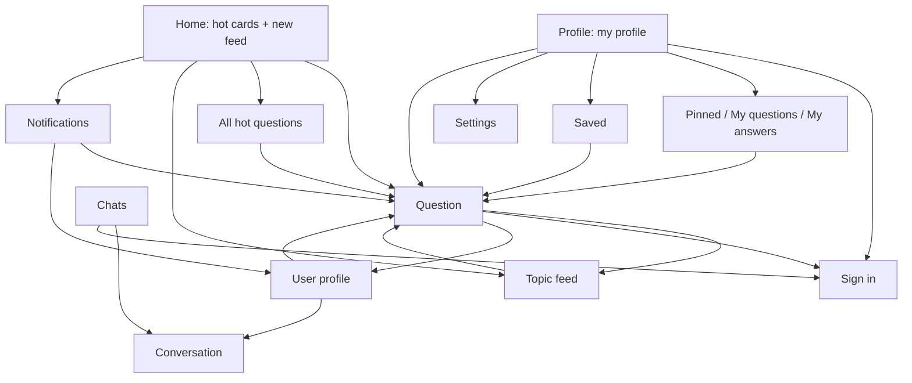

# SPEC-02: Design

*Applies [DESIGN-PHILOSOPHY.md](DESIGN-PHILOSOPHY.md). Vocabulary mapping: **item** = question · **artwork** = the question's cover (or a monogram) · **hero screen** = the question screen · **now surface** = none in v0.1 (a reply in progress may become one later).*

## 1. Principles for this app

1. **Reading first.** Text is the content. Generous line height, comfortable margins, nothing competes with the question.
2. **One tap to the question.** Rows open the question; secondary actions sit in the top bar.
3. **The site stays one tap away.** "Open on Stips" everywhere content appears; we're a better window, not a replacement.
4. **Calm chrome, colorful content.** Channels bring their own colors; the rest follows the wallpaper.

## 2. Design system

| Token | Value |
|---|---|
| Color | Dynamic color (Android 12+). Fallback seed: Stips green `#09C286`. Accent presets: `#09C286` (default) + the 8 presets of DESIGN-PHILOSOPHY Appendix A |
| Scheme generator | DESIGN-PHILOSOPHY §2.2 in CIELAB (`ui/theme/SchemeGenerator.kt`), tone table from Appendix A |
| Channel tint | A question in a channel uses a scheme generated from the channel's first gradient color |
| Pure black | Dark mode option; surfaces from Appendix A |
| Type | Roboto (platform), M3 type scale; Hebrew falls back to the platform's Hebrew font |
| Shapes | Search pill 28 dp · cards 20 dp · grouped settings 24/4 dp, 2 dp gaps · covers: squircle, 28% corners |
| Spacing | 4 dp grid; 16 dp screen margins |
| Icons | Material Symbols (outlined; filled = selected), from the Compose icon set |

## 3. Information architecture



## 4. Navigation and adaptive layout

- **Bottom bar:** Home · Pen pals · Chats · Profile (icons with labels; filled icon when selected; Chats shows the unread count). It hides on inner screens, sliding away. Tapping the open tab scrolls it back to the top (v0.12, D-78) and reloads it, its pull-to-refresh spinner showing (v0.13, D-89).
- **Back:** system back and predictive back everywhere; the top bar's back arrow mirrors in RTL.
- **Motion (D-32):** a new screen slides in from the end over the current one, which drifts a quarter of the way toward the start; Back reverses it. Tabs fade through (out 90 ms, in 210 ms). During the predictive back gesture the screen follows the finger toward the edge it was swiped from, and the screen below slides in from a quarter away. The *Animations* switch turns all of it off.
- **Deep links:** `https://stips.co.il/ask/<id>` opens the question, `/profile/<id>` the profile, `/messages` the Chats tab. The same links work from phone notifications and inside answers.
- **Widths:** phone-first (compact). Rail and two-pane layouts are backlog items.

## 5. Screens

### 5.1 Home

```
┌──────────────────────────────────────┐
│ ( 🔍 Search a topic            ) 🔔² │  pill + notifications bell with badge
│ (All) (● Music) (● Studies) (● Tech)…│  channel chips, scroll
│ Hot right now                See all │
│ ┌────────────────┐ ┌───────────      │  5 cards, 280×196 dp, snap scroll
│ │ cover photo  1 │ │ cover…          │  rank badge, dark gradient,
│ │ Title over the │ │                 │  white title on the photo
│ │ photo, 3 lines │ │                 │
│ └────────────────┘ └───────────      │
│ New questions           (● Live)     │  Live chip: pulsing dot when on
│ ▢  Is my pendant nice? Paid 1000 ₪…  │  56 dp cover · title, 3 lines
│    3 answers · 2 pins · 5 min · Mendy│
│               …                      │
└──────────────────────────────────────┘
```

- Pull to refresh reloads both. The next page of New loads near the end; "That's everything" at the end. (v0.9 had a small ⟳ beside "New questions" while Live was off; v0.10 removed it.)
- **Live** (off by default, also in Settings): every 30 s while Home is on screen, new questions slide in at the top (items animate into place).
- **Layouts (v0.9, D-59), in Settings → Home and reading:** *Hot, then new* (above, the default) · *Like the website*: the hot cards, then today's questions in sections, each under a heading with a thin rule ("#topic ›" opens the topic; a list's title is plain), loading more while scrolling, with no New list and no Live · *New only*: the chips and the New list. Also: 3, 5 or 10 hot cards; hot from now, today or this week (the title follows: "Hot today"…); the chip row on or off.
- First launch with nothing cached: skeleton cards and rows. Later launches: the last-seen page at once.
- Errors replace the list only when nothing is shown: "Can't reach Stips right now." + *Retry*. Otherwise a snackbar with *Retry*.

### 5.2 Question (compact hero)

```
┌──────────────────────────────────────┐
│ ←                     📌3  🔔  ⤴  ⋮  │  pin+count · updates · share · more
│░░░░░░░░ cover photo, cropped ░░░░░░░░│  the photo is a background,
│░░░░░░░░░░░░░░░░░░░░░░░░░░░░░░░░░░░░░░│  slight parallax on scroll
│▒▒ Is my pendant nice? Paid 1000 ₪… ▒▒│  title fades out of the photo
│ ◯ Mendy · 5 min · Studies · 3 pins   │  (surface gradient at its bottom)
│ #money #prices · 🔗 example.com      │  compact tags · the asker's link
│ Body text, 3 lines…        Show more │  clamped
├──────────────────────────────────────┤  ≤ half the screen until here
│ 3 answers                            │
│ ┌──────────────────────────────────┐ │
│ │ ◯ Anonymous · 24 min    🌸   ⋮   │ │  ⋮ on your own answers:
│ │ Answer text…                     │ │    Edit (while allowed) · Detach
│ │ 🔗 Source                         │ │  the answer's link
│ │ ▲ 4 ▼                            │ │
│ └──────────────────────────────────┘ │
├──────────────────────────────────────┤
│ (Anonymous) (🔗 Add link) (🔔 Get updates) │  composer chips
│ [ Write an answer…          ] (➤)    │
└──────────────────────────────────────┘
```

- Scrolling down collapses the header into a top bar that shows only the question's title (fade and slide, on a surface that tints as it fills). The cover is clipped to the header over a solid surface, so it never shows past the header while it drifts (#4).
- The meta row: the asker (photo + name, cut with "…") at the start; 💬 answers, 📌 pins and 🕒 time at the end. Feeds and hot cards use the same row.
- ⋮ in the top bar: Open on Stips, View image (full screen, zoom), Photo credit; on your question Edit, Detach, Delete; on others' Report, Hide, Hide everything from this user. Each answer has its own ⋮ (yours: Edit, Detach, Delete; others': Report, Hide, Hide everything from this user). The asker sees *Send a flower* on eligible answers.
- The composer's options are three short chips (Anonymous · Link · Updates) that fit without sideways scrolling; editing puts the cursor at the end and opens the keyboard.
- Without a cover the header is tinted surface; nothing else changes.
- *Add link* opens a dialog with one field ("Paste the link here"); the link's page title becomes its name, as on the site. One link per answer.
- Editing an answer reuses the composer with a banner "Editing your answer" and Cancel.
- Signed out, the composer is a tonal button: *Sign in to answer*; pin and updates lead to sign-in.
- Tinted with the channel's scheme when the question has a channel.
- Not found (`API_ERROR_EOF`): "This question was deleted or doesn't exist." + *Go back*.
- **v0.9:** pull down to reload the question and its answers (the spinner comes down below the top bar). The asker's own answers carry a small tertiary pill, "שואל השאלה" / "שואלת השאלה", after the name. Verified accounts (organizations, Stips' own) show a blue ✓ after the name, and their answers a thin blue outline. Answers follow the chosen order (as on Stips, newest, oldest, most votes); since v0.16 it's picked in the question (below). In expert mode: an id line under the hero and under each name, *Server details* in the ⋮ menus, and the load time at the end.
- **v0.10, replies (D-68, D-69):** dragging an answer from left to right slides it after the finger, revealing a ↩ that grows in; past 64 dp a haptic tick, and letting go starts a reply (the card springs back). The composer then shows a bar (start-side primary stripe, ↩, "Replying to Dana", her first line, ✕) and the draft opens with "^^" and a line break, cursor at the end, keyboard up. ⋮ → *Reply* does the same. An answer that points up shows, between its header and its text, one to three quotes: a rounded box tinted with 8 % primary, a 3 dp primary stripe on the start side, the author in primary labelMedium and two lines of their text in bodySmall; a tap scrolls there. The text below stays as written (v0.11): every pointer in it, at the start or further on, is bold primary and tappable. *Hide the carets* (Settings, off by default) leaves out the opening ones that the quotes show.
- **v0.10, notifications and moderators (D-70, D-71):** opened from a notification, the screen scrolls the first new answer (or the user's flowered one) to just below the folded top bar, and its card breathes: its surface goes to primary container and back twice over two seconds. A moderator's name is followed by a pill in Stips' purple (tonal, 14 % container) with a 12 dp shield: "נאמן סטיפס" / "נאמנת סטיפס", or "נאמן בכיר" / "נאמנה בכירה".
- **v0.13, the "unread" bar (D-80):** for new answers the breathing gave way to a thin band right above the first new one: full card width, primary container at 85 %, 8 dp corners, "N unread answers" centered in labelMedium semibold. The jump puts the band just under the folded top bar. It folds away (shrinks and fades) after a pull to refresh or the user's own answer. A flower notification still breathes. Below 50 credibility points, swiping and ⋮ → *Reply* are gone (D-85).
- **v0.13, #10:** an edited answer's time line reads "5 min · edited", the word in primary; it (or ⋮ → *Edit history*, with a ⟲ icon) opens a tall sheet of version cards, newest first: the current one on primary container, earlier ones on surfaceContainer, each with *Now* / *Earlier version* / *Original* in primary labelLarge, "Edited by the answerer · 2 h" (or "Posted · …"), the text and its links (D-88). Scores are green above zero and red below (D-90). A small secondary-container FAB at the bottom end (16 dp in) shows ↓ and goes to the last answer; once the header has folded away the arrow turns half a turn (300 ms) and goes back to the top; it fades and scales in and out with the thread's scrollability (D-91).

- **v0.16 (D-113):** by "N answers", a small sort button (20 dp icon in a 36 dp button) opens a menu: *Default* · *Newest first* · *Most upvotes* · *Least upvotes*, the current one checked. Another order shows its name before the icon, both in the accent color. Each visit starts in *Default*.
- **Swipes (v0.16, D-110):** answers and chat messages swipe as questions in lists do: past 64 dp (chats 56), or a flick.

### 5.3 Chats

```
┌──────────────────────────────────────┐
│ Chats                                │
│ ◉ Yael              14:02        (2) │  unread badge in primary; ◉ = the green
│   Thanks for the answer!             │  online dot, as on profiles (#6)
│ ◯ Omer              Yesterday        │
│   ok                                 │
└──────────────────────────────────────┘
```

The list updates by itself when the unread count changes (checked every 10 s while the app is open) and on returning from a chat. Pulling it down also makes sure the session is alive (#9). The top bar's ⚙ (tune) opens **DM settings** (v0.12, D-76): a sheet with *Replies* (easy reply, show what messages reply to, hide the carets), *Notifications* (phone notifications; while on, message notifications and Android's sound and pop-up settings) and the chats widget. Settings has the same page.

Signed out: an invitation card — "Sign in to see your chats" + *Sign in*.

### 5.4 Conversation

```
┌──────────────────────────────────────┐
│ ←  ◉ Yael                         ⋮  │  photo with the green online dot; tap → profile
│      Online now                      │  only while they're online; ⋮ → Report Yael,
│         ╭──────────────╮             │  Block / Unblock messages (v0.8)
│         │   ◉ (72 dp)  │             │  at the very start (no more history):
│         │     Yael     │             │  photo, name, status, credibility ·
│         │ Credibility… │             │  answers · flowers, time on Stips,
│         ╰──────────────╯             │  "View profile"
│    This is where your conversation…  │
│  ┌──────────────┐                    │  theirs: start side, surfaceContainerHigh
│  │ hi, saw your…│                    │  same sender: 2 dp apart, otherwise 10 dp
│  └──────────────┘                    │
│  14:05                               │  the time shows only after a tap
│                   ┌───────────────┐  │  mine: end side, primaryContainer
│                   │ thanks!       │  │  long-press copies
│                   └───────────────┘  │
│                               (↓)²   │  scrolled up: jump to the newest; the badge
├──────────────────────────────────────┤  counts their messages since (v0.8)
│ [ Message…                 ] (➤)     │  blocked: "You blocked messages from Yael."
└──────────────────────────────────────┘  + Unblock, in place of the composer
```

Earlier messages load by themselves as the top comes into view; there's no "Load earlier" button (#6). Every visit starts with all times folded. The chat asks for new messages every 3 s while it's on screen, and not while their messages are blocked.

**Report** is a dialog with the site's five reasons as radio buttons (spam or ads; sexual messages or offers; insults; suspicious questions about personal details; something else), then an optional details field. **Block** asks first; unblocking doesn't.

**Replies (v0.12, D-75):** as answers (§5.2): dragging a bubble from left to right slides it after the finger with a ↩ growing in on the left; past 56 dp a haptic tick, and letting go starts a reply. Above the box: a bar with a start-side primary stripe, ↩, "Replying to Yael" (or "Replying to your message"), the first line, ✕. A message that points up shows, inside its bubble above the text, a quote: a 3 dp primary stripe, the author ("You" for one's own) in primary labelMedium, two lines in bodySmall, on a 7 % tint of the bubble's text color; quote and text share the wider width. A tap on the quote, or on a pointer in the text, scrolls there, and that bubble breathes toward tertiary container for two seconds. ⚙ in the top bar opens DM settings, as in the list.

**Unread (v0.13, D-81):** the same band as in questions, "N unread messages", sits right above the first message that was unread on opening. When the unread ones fill more than the screen, the chat opens with the band 48 dp below the top and the ↓ badge counting them; otherwise at the newest. Writing a message folds it away; it's gone on the next visit. **Below 5 flowers** (D-87), not a moderator: a bar with a 🌸 and the site's words ("שליחת מסרים פתוחה למשתמשים בעלי 5 פרחים ומעלה. כרגע יש לך N פרחים…") takes the composer's place.

### 5.5 Profile (everyone's, social-style)

```
┌──────────────────────────────────────┐
│ ←  Itay (appears on scroll)   ⤴  ⚙   │  ⚙ only on your own profile
│ ◯ photo 📷     120      3,816  1,387 │  stats: questions · answers ·
│ (88 dp)     Questions Answers Flowers│  flowers (tap → that graph)
│ Itay                                 │  headlineSmall bold
│ Online now                           │  only for others
│ (🏅 Senior answerer) (🎂 17) (📅 On Stips for 6 years, 9 months) │
│ Bio text…                            │
│ ( 💬 Message )   or   ( ✎ Edit bio ) │
│ ┌──────────────────────────────────┐ │
│ │   ◜‾‾‾‾◝    Credibility          │ │  semicircle gauge, the site's
│ │  (  93  )   Perfect              │ │  four bands tuned to the theme,
│ │             +1 every 3–7 days    │ │  fills in reading direction;
│ │             What it means…       │ │  Stips' rating (v0.13); tap → sheet
│ └──────────────────────────────────┘ │
│ Your lists: Pinned · My questions · My answers (· Saved)   │ own profile only
│ [  Activity  |  Thanks wall  ]       │  sticky tabs
│ [Answers|Questions|Flowers]          │  segmented
│ 142  In the last 6 months            │  tap a bar: that week's count
│ ▁▃▅▂▇▁▁▃▅▆▂▁▃▅▂▇▁▁▃▅▆▂▁▃▅▂           │  26 weekly bars, oldest → newest
│ Flowers: answers that got a flower (question title, answer, time) │
│ Thanks wall: speech bubbles from their writers; 🗑 on your own    │
└──────────────────────────────────────┘
```

- Tapping any name or avatar (answers, thanks wall, chats, notifications) opens that user's profile. On the profile, tapping the photo opens it full screen.
- Tabs: **Thanks wall** (first and default; others can write on it) · **Activity**.
- On your own profile: the camera button picks a new photo (system photo picker; straightened, cropped square, uploaded), *Edit bio* opens a dialog (250 characters).
- Signed out, the Profile tab is a `secondaryContainer` card — "Sign in to answer, chat and see your questions" + *Sign in*; then Saved and Settings.
- **Special accounts (v0.9, D-64):** Stips' gradient background as a 64 dp rounded band behind the top of the photo; the name in Stips' purple when it highlights it, with a blue ✓; an *Organization* (or *Stips' own account*) pill and `custom_rank` pills first among the badges; no age pill or numbers when Stips hides them. In expert mode, "user #id" under the name and *Server details* in the top bar.
- **Stips+ badge (v0.16, D-116):** when the bio has the *I use Stips+* line (its words or its link), a pill with ✨ and "Stips+" in white on the bio button's gradient (Stips green into blue and purple) comes right after any special badge.
- **Credibility sheet (v0.13, D-86):** tapping the gauge opens a tall sheet: the number in the band's color with "Credibility · Perfect" and its rate; status lines with icons (editing open from 50 or not; blocked days or for good); a card *When will the points reach…* with the target, a slider over the points ahead (it starts at the next milestone) and the day ("Around 3 Mar 2027, in 12 days", or "Between … and …" from 90 up) plus "If no points are taken away"; *Milestones* (30 back to activity, 50 editing, each rating, 100) with their dates; Stips' table with the current rating highlighted; on one's own profile, *Goals*: the senior answerer bar (500 flowers) and the moderator requirements with ✓, ✕ or ? (age, 100 points, 3,000 flowers, a year and a half, a year since the last block); then where it all comes from.
- **Block screen (v0.13, D-84):** over the whole app, a 🚫 in an error-container circle, the title ("You're blocked from activity for now", "This account is blocked for good" or "Stips has blocked this account"), Stips' reason in a card, "Ends: …" or "About N more days" with the date, the points, the rule in one line, "You can still read…", then *Continue reading* (filled), *Contact Stips* (outlined), *Stips' rules* and *Sign out* (text). Back also continues.

### 5.6 Sign in

```
┌──────────────────────────────────────┐
│ ←  Sign in to Stips                  │
│ [ Email                          ]   │
│ [ Password                     👁 ]   │
│ ( Sign in )                          │  progress inside the button
│ Your password goes only to Stips.    │  bodySmall
│ Stips+ keeps only the sign-in token. │
│ Create an account on Stips ↗         │
│ Forgot your password? ↗              │
└──────────────────────────────────────┘
```

**Welcome (v0.9, D-61):** on the first launch after installing, the same form covers the app under "Stips+" (display, primary), "Welcome" and a line about the app, with *Continue as a guest* (outlined) under *Sign in*. Either one closes it for good; updates, links and shortcuts skip it.

**Intro (v0.14, D-98):** replaces the welcome screen. A top row: ← (from the second step), dots for the steps (the current one long), *Skip* on the choice steps. Steps: **Welcome** ("Stips+" display, "Welcome", a line, the look's picture; *Skip* · *Let's go*) → **Pick your look** (the look's picture, Theme System/Light/Dark, Dynamic color, accent swatches) → **Your Home** (the three layouts as pictures, Live new questions) → **Replies, made clear** (two answers replying, Easy reply · Show what answers reply to · Hide the carets, for answers and chats together) → **Sign in to Stips** (the sign-in form, *Continue as a guest*) → **Get notified on your phone?** (signed in: a notification's picture; *Not now* · *Turn on*) → **You're all set** (a check; *Start using Stips+*). Choices apply at once; the pages slide with the reading direction.

**v0.16 (D-114):** a **Swipes** step after *Replies*: "Swipe for quick actions", the picture of a question slid each way with *Swipe right* and *Swipe left* lines (each opens the list of choices), then the picture of two answers slid left (someone's, and one under your nickname) with the two answer lines, and "Swipe an answer to the right to reply to it". In *Replies*, the carets in the words are bold in the accent color.

### 5.7 Settings

**v0.16:** *Questions and answers* loses *Order of answers* (it's in the question now) and gains, under **Swiping an answer**, a picture of two answers slid left over their actions: someone's, and one under your own nickname ("You" when signed out). Live's controls (Home, and the Pen pals sheet) add "Home and Pen pals check at the same rate." Messages at the bottom of every screen swipe away down or sideways (D-111).

**v0.15 (#18):** *Appearance* ends with **Animations**: radio rows *Full animations*, *Less animations*, *No animations*, *Customized*; with *Customized*, switches follow for *Moving between screens*, *Jumping to an answer or a message*, *Scrolling to the top*, *Glow*, *Moving elements* and *Quick*. *Home* adds **Swiping a question**: a picture of a row slid each way over its action, and *Swipe right* / *Swipe left* rows that open a list to pick from. *Questions and answers* adds **Swiping an answer**: *Swipe left on someone's answer* and *on your answer*. *Notifications* adds **Kinds of notifications** (three rows opening Android's settings for each channel) and **The notifications list** (*Show questions' titles and photos*).

**v0.14 (D-97):** an account card (photo, nickname; signed out, *Sign in to Stips*), then three groups, each row with what's chosen now: **Make it yours** — *Appearance* (the look's picture, then Colors and Interface), *Home* (the layouts as pictures, Hot questions, Live new questions, More for Home: channel chips, open the app on), *Questions and answers* (two answers replying, as the switches set them; Answers and replies; Order of answers; Times), *DM settings* (two chat bubbles, then the chat switches; the same in the chats screens' sheet). **On your phone** — *Notifications* (a notification's picture, phone notifications, how often, their status), *Widgets*. **More** — *Privacy and safety*, *Stips* (contact, rules, about), *About* (version, source, license, report a problem, disclaimer; *Show the intro again*; For experts: *Expert mode*, and with it *Diagnostics*). *Delete account* is on the account page.

**v0.9 (D-66):** a main page of rows with icons, each opening a page: **Account** (signed in: Profile photo and bio → your profile · Safe mode · Account details ↗ · Change password ↗ · Sign out; signed out, the row is *Sign in to Stips*) · **Home and reading** (Home's layout, radio rows · Hot questions on Home 3/5/10 · Which hot questions · Channel chips · Open the app on · Order of answers · Answers and replies, v0.10: Easy reply · Show what answers reply to · Moderator badges on answers · Count the seconds) · **Appearance** (Dynamic color · Accent swatches · Theme · Pure black · Show images · Animations) · **Notifications and widgets** (Phone notifications · Live controls · "Hot right now" widget · Chats widget) · **Privacy and safety** (Anonymous mode · Hidden content) · **Stips** (Contact ↗ · Rules ↗ · About Stips ↗ · Delete account ↗) · **About** (version, source, license, report a problem, disclaimer). Then **For experts**: *Expert mode*, and with it on, **Diagnostics** (network log, recent load times). ↗ rows open the Stips site in the browser.

Before v0.9, groups on one page (DESIGN-PHILOSOPHY §8): **Stips account** (signed in: Profile photo and bio → your profile · Safe mode · Account details ↗ · Change password ↗ · Sign out) · **Updates** (Phone notifications · Live new questions, each with its data cost) · **Colors** (Dynamic color · Accent swatches · Theme System/Light/Dark · Pure black) · **Interface** (Show images · Animations) · **Performance** (recent timings) · **Stips** (Contact ↗ · Rules ↗ · About Stips ↗ · Delete account ↗) · **About** (version, license, source, report a problem, disclaimer).

### 5.9 Ask a question

```
┌──────────────────────────────────────┐
│ ✕  Ask a question                    │
│ (In the Studies channel ✕)           │  only when asked from a channel
│ [ Your question              14/120 ]│  10–120 characters
│ [ More details (optional)   0/2000 ] │
│ (👤 Ask anonymously) (🔗 Add link)    │  anonymous → nickname field
│ ▬▬▬▬▬▬▬▬▬▬░░░░░░░░░░                 │  step 1 of 3
│ Step 1 of 3          ( Back ) (Next) │
└──────────────────────────────────────┘
```

- Step 2: chosen tags (removable, 1–5), "Add a tag" with Stips' completions, suggested tags as filter chips.
- Step 3: a photo grid from Stips' gallery for the first tag (search to change); tap to select (check mark); *Post*.
- A YouTube link skips the photo step. Over the daily cap: a card says how many questions a day are allowed.
- After posting, the new question opens in place of this screen. Anonymous mode forces *Ask anonymously*.

### 5.10 Pen pals (tab)

- Top bar "Pen pals"; a short intro line; cards with avatar (online dot), name, time and the message; ⋮ → Report / Hide / Hide everything from this user, or Delete on your own post.
- **v0.16 (D-115):** the top bar ends with the Live chip, as on Home: a tap turns it on or off, a long press opens *Live pen pals* (the switch, the shared rate, "Each check reads the board's newest 30 posts"). New posts slide in on top; at the top, the list scrolls to show them. Entering the tab, or coming back to the app on it, brings new posts in the same way.
- Tap a card → the private chat with its author (sign in first if needed).
- *New post* opens a sheet: 255 characters, "My last message", *Send*; or explains what's missing (sign in, 5 flowers, the posting interval).
- Signed-in users outside ages 13–21 see Stips' "for teens" message instead of the board.

### 5.8 Notifications

```
┌──────────────────────────────────────┐
│ ←  Notifications                     │
│ ┌ Get notified on your phone       ┐ │  only while phone notifications
│ │ …every few minutes while you use │ │  are off; *Turn on* asks Android's
│ │ your phone…                      │ │  permission (13+), then whether
│ └ ( Turn on )                      ┘ │  Stips+ may run in the background
│ (💬) Dana answered your question… • │  unread: bold, tinted row, dot
│      5 min                           │
│ (🌸) Your answer got a flower        │  icon by type: answer, flower,
│      2 h                             │  thanks, badge, message, other
└──────────────────────────────────────┘
```

- **v0.15 (#13, D-104):** under the phone card, filter chips *All · Updates · Flowers and thanks · System messages* (a badge counts the new ones in each; tapping the chip that's on turns it off). In *All*, a rounded secondaryContainer line: "New since your last visit: 12 new answers on 3 questions · 2 flowers · a thanks message". Then **From Stips' team**: the team's unopened notices from the last 30 days as tinted cards (errorContainer for a removal, tertiaryContainer otherwise) until opened. Then sections **Today · Yesterday · This week · Earlier**. A long press on a row opens a small menu: *Mark as read* (new or pinned ones), *Stop updates* (on an update; the message offers *Undo*). With a category chosen, older pages load one at a time with *Load older notifications* (a rare kind may never fill the screen); in *All* they load as you scroll.
- Rows are uniform (icon, two lines of text, time; a note or removed points on one extra line). New items (Stips' `viewed` flag, or newer than what the app last showed) are bold, lightly tinted and dotted. Times: the time for today and yesterday (the section says the day), else the date. With *Show questions' titles and photos* on (Settings → Notifications), a row about a question adds its title (when the sentence doesn't already say it) and a 44 dp photo.
- **Stips' team (v0.13, D-82):** a removal (⚖ on error container), a report's outcome (⚑) or a note (🛡) starts with who it's from ("Removed by Stips' team", "About your report", "From Stips' team"), takes up to three lines, shows the team's words in a rounded surfaceContainerHigh box (as the site's "system-msg"), and "N credibility points removed" in error. A tap opens a dialog: the text, *The team's words*, the points, "Your credibility now: 61, Reliable. Rises by a point a day.", and for a removal how to appeal, with *Contact Stips*, *Open* (the question or profile) and *Close*.
- Tapping opens the question or profile. Pull to refresh; older pages load at the end.
- Opening the list clears the bell's badge (Stips marks them seen, as on the site), and takes the phone's notifications about answers, flowers and thanks out of the shade (v0.11).
- Phone notifications (v0.11, D-73; channels per kind since v0.15): channels that pop up, *Updates*, *Flowers and thanks*, *System messages* and *Messages*. Up to 5 new items per check, each opening its item in the app; one notification per chat with unread messages (who wrote, the last message, a count), opening the chat. Opening a chat clears its notification.

### 5.9 Phone notifications in Settings (v0.11, D-74)

```
┌──────────────────────────────────────┐
│ Phone notifications            [on]  │
│ How often to check                   │
│ (1 min)(2 min)(5 min)(15 min)        │  while the phone is awake
│ Last check at 14:32: nothing new.    │
│ ⚠ Battery saving holds the checks    │  only while Android saves battery
│   back … ( Allow )                   │  on Stips+; likewise "off in
│ ( Check now )  Send a test           │  Android" and "restricted"
└──────────────────────────────────────┘
```

- The status line: no check yet; nothing new; how many were sent; or that the last check couldn't reach Stips (with the error code). Times are clock times.
- Warnings, each with its fix: notifications off in Android (→ the app's notification settings), restricted background use (→ app info), battery saving (→ Android's own "let it run in the background?" question), and, when none of those applies, no check for an hour (→ app info). They're read again whenever the screen comes back.
- *Check now* runs a check at once and says what it found; *Send a test* posts a sample. Expert mode adds a line with Android's standby group, the last run and the interval.
- **The offer** (once, signed in, after the welcome): "Get notified on your phone?" (*Turn on* / *Not now*), or, when they're already on but Android saves battery on Stips+, "Let notifications arrive on time" (*Allow* / *Not now*).

## 6. System surfaces

| Surface | Since v0.2 |
|---|---|
| Share sheet | Question and profile links |
| Browser | "Open on Stips", sign-up, password reset, the account pages in Settings |
| Link handling | `stips.co.il/ask/…`, `/profile/…`, `/messages` (user-enabled) |
| Notifications | Opt-in phone notifications in two channels that pop up (*Answers and activity*, *Messages*), checked every few minutes while the phone is awake and about every 15 minutes otherwise (v0.11) |
| Photo picker | Choosing a profile photo (no storage permission) |
| Home-screen widget | "Hot right now" (v0.6, D-51): hot questions, ⟳, taps open the app |
| Chats widget | v0.9, D-67: latest chats with name, last message, clock time and an unread badge (bold when unread); the title counts unread; a tap opens the chat; signed out, a line asks to sign in |
| Launcher shortcuts | *Hot* and *Chats* (v0.8, D-57): touch and hold the icon; Material glyphs in deep Stips green on the light circle of the shortcut icon guidelines |

## 7. Localization

- English (`values/`) and Hebrew (`values-iw/`). The app follows the phone's language.
- Hebrew copy is gender-neutral: plural or infinitive forms ("לכתוב תשובה", "אפשר לנסות שוב").
- User content sets its own direction (Hebrew questions read RTL even in the English UI); Latin names and numbers inside Hebrew text are isolated.
- Relative times are formatted in the user's language from the server's absolute time (Asia/Jerusalem).

## 8. Accessibility

- Question rows read as one sentence: "Is my pendant nice?, 3 answers, 5 minutes ago, by Mendy".
- Every icon button has a label; vote buttons announce the score.
- Text scales to 200%: titles wrap to 3 lines, rows grow.
- Reduced motion: the in-app *Animations* switch and the system animation scale turn transitions into fades.

## 9. Content and tone

- Sentence case, verbs on buttons, no exclamation marks.
- Errors say what happened and what to do: "Can't reach Stips right now. Check your connection and try again."
- Disclaimer (About, sign-in screen footer): "An independent app, not affiliated with Stips."
