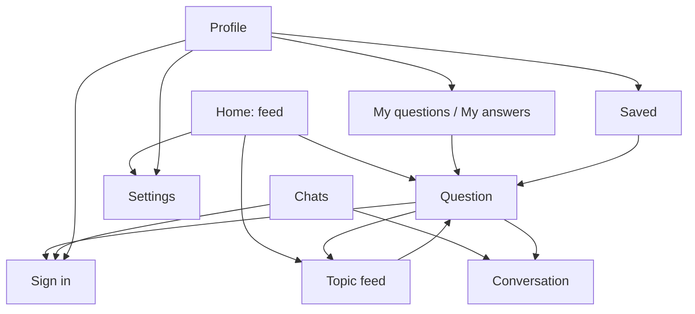

# SPEC-02: Design

*Applies [DESIGN-PHILOSOPHY.md](DESIGN-PHILOSOPHY.md). Vocabulary mapping: **item** = question · **artwork** = the question's cover (or a monogram) · **hero screen** = the question screen · **now surface** = none in v0.1 (a reply in progress may become one later).*

## 1. Principles for this app

1. **Reading first.** Text is the content. Generous line height, comfortable margins, nothing competes with the question.
2. **One tap to the question.** Rows open the question; secondary actions sit in the top bar.
3. **The site stays one tap away.** "Open on Stips" everywhere content appears; we're a better window, not a replacement.
4. **Calm chrome, colorful content.** Channels bring their own colors; the rest follows the wallpaper.

## 2. Design system

| Token | Value |
|---|---|
| Color | Dynamic color (Android 12+). Fallback seed: Stips green `#09C286`. Accent presets: `#09C286` (default) + the 8 presets of DESIGN-PHILOSOPHY Appendix A |
| Scheme generator | DESIGN-PHILOSOPHY §2.2 in CIELAB (`ui/theme/SchemeGenerator.kt`), tone table from Appendix A |
| Channel tint | A question in a channel uses a scheme generated from the channel's first gradient color |
| Pure black | Dark mode option; surfaces from Appendix A |
| Type | Roboto (platform), M3 type scale; Hebrew falls back to the platform's Hebrew font |
| Shapes | Search pill 28 dp · cards 20 dp · grouped settings 24/4 dp, 2 dp gaps · covers: squircle, 28% corners |
| Spacing | 4 dp grid; 16 dp screen margins |
| Icons | Material Symbols (outlined; filled = selected), from the Compose icon set |

## 3. Information architecture



## 4. Navigation and adaptive layout

- **Bottom bar:** Home · Chats · Profile (icons with labels; filled icon when selected). It hides on inner screens.
- **Back:** system back and predictive back everywhere; the top bar's back arrow mirrors in RTL.
- **Deep links:** `https://stips.co.il/ask/<id>` opens the question screen.
- **Widths:** v0.1 is phone-first (compact). Rail and two-pane layouts are backlog items.

## 5. Screens

### 5.1 Home

```
┌──────────────────────────────────────┐
│ ( 🔍 Search a topic            ) ⚙   │  pill, surfaceContainerHigh
│ [  New  |  Hot  ]                    │  segmented
│ (All) (● Music) (● Studies) (● Tech)…│  channel chips, scroll
│ (Now) (Today) (Week)          ← Hot  │  window chips, only for Hot
├──────────────────────────────────────┤
│ ▢  Is my pendant nice? Paid 1000 ₪…  │  56 dp cover · title, 2 lines
│    3 answers · 5 min · Mendy         │  bodyMedium, onSurfaceVariant
│ ▢  What's the best way to study…     │
│    12 answers · 1 h · Anonymous      │
│               …                      │
└──────────────────────────────────────┘
```

- Pull to refresh; the next page loads near the end; "That's everything" at the end.
- First launch with nothing cached: 6 skeleton rows. Later launches: the last-seen page at once.
- Errors replace the list only when nothing is shown: "Can't reach Stips right now." + *Retry*. Otherwise a snackbar with *Retry*.

### 5.2 Question (hero)

```
┌──────────────────────────────────────┐
│ ←                        🔖  ⤴  ↗   │  save · share · open on Stips
│ ┌──────────────────────────────────┐ │
│ │          cover image             │ │  20 dp corners, max 220 dp
│ └──────────────────────────────────┘ │
│ Photo: Damien Dufour · Unsplash      │  labelSmall
│ Is my pendant nice? Paid 1000 ₪…     │  headlineSmall, bold
│ Body text with a https://link…       │  bodyLarge, selectable
│ (#money) (#prices)                   │  topic chips → topic feed
│ ◯ Mendy · 5 min · Studies            │  avatar + meta
│ 3 answers                            │  titleMedium
│ ┌──────────────────────────────────┐ │
│ │ ◯ Anonymous · 24 min      🌸     │ │  answer card, surfaceContainerLow
│ │ Answer text…                     │ │
│ │ ▲ 4 ▼                            │ │  vote (signed in)
│ └──────────────────────────────────┘ │
│ Loaded in 0.31 s                     │  labelSmall
├──────────────────────────────────────┤
│ [ Write an answer…          ] (➤)    │  composer; anonymous switch above
└──────────────────────────────────────┘
```

- Signed out, the composer is a tonal button: *Sign in to answer*.
- Tinted with the channel's scheme when the question has a channel.
- Not found (`API_ERROR_EOF`): "This question was deleted or doesn't exist." + *Go back*.

### 5.3 Chats

```
┌──────────────────────────────────────┐
│ Chats                                │
│ ◯ Yael              14:02        (2) │  unread badge in primary
│   Thanks for the answer!             │
│ ◯ Omer              Yesterday        │
│   ok                                 │
└──────────────────────────────────────┘
```

Signed out: an invitation card — "Sign in to see your chats" + *Sign in*.

### 5.4 Conversation

```
┌──────────────────────────────────────┐
│ ←  ◯ Yael                            │
│          ( Load earlier messages )   │
│  ┌───────────────┐                   │  theirs: start side, surfaceContainerHigh
│  │ hi, saw your… │                   │
│  └───────────────┘                   │
│                   ┌───────────────┐  │  mine: end side, primaryContainer
│                   │ thanks!       │  │
│                   └───────────────┘  │
├──────────────────────────────────────┤
│ [ Message…                 ] (➤)     │
└──────────────────────────────────────┘
```

### 5.5 Profile

```
┌──────────────────────────────────────┐
│        ◯ (photo)                     │
│        Itay · 1,240 points           │
│ ┌ My questions                     ┐ │  grouped card rows
│ ├ My answers                       ┤ │
│ └ Saved                            ┘ │
│ ┌ Settings                         ┐ │
│ └ Sign out                         ┘ │
└──────────────────────────────────────┘
```

Signed out: a `secondaryContainer` card — "Sign in to answer, chat and see your questions" + *Sign in*; then Saved and Settings.

### 5.6 Sign in

```
┌──────────────────────────────────────┐
│ ←  Sign in to Stips                  │
│ [ Email                          ]   │
│ [ Password                     👁 ]   │
│ ( Sign in )                          │  progress inside the button
│ Your password goes only to Stips.    │  bodySmall
│ Stips+ keeps only the sign-in token. │
│ Create an account on Stips ↗         │
│ Forgot your password? ↗              │
└──────────────────────────────────────┘
```

### 5.7 Settings

Groups (DESIGN-PHILOSOPHY §8): **Colors** (Dynamic color · Accent swatches · Theme System/Light/Dark · Pure black) · **Interface** (Show images · Animations) · **Performance** (recent timings) · **About** (version, license, source, report a problem, disclaimer).

## 6. System surfaces

| Surface | v0.1 |
|---|---|
| Share sheet | Question links |
| Browser | "Open on Stips", sign-up and password reset |
| Link handling | `stips.co.il/ask/…` (user-enabled) |
| Notifications, widget, shortcuts | Later (SPEC-06) |

## 7. Localization

- English (`values/`) and Hebrew (`values-iw/`). The app follows the phone's language.
- Hebrew copy is gender-neutral: plural or infinitive forms ("לכתוב תשובה", "אפשר לנסות שוב").
- User content sets its own direction (Hebrew questions read RTL even in the English UI); Latin names and numbers inside Hebrew text are isolated.
- Relative times are formatted in the user's language from the server's absolute time (Asia/Jerusalem).

## 8. Accessibility

- Question rows read as one sentence: "Is my pendant nice?, 3 answers, 5 minutes ago, by Mendy".
- Every icon button has a label; vote buttons announce the score.
- Text scales to 200%: titles wrap to 3 lines, rows grow.
- Reduced motion: the in-app *Animations* switch and the system animation scale turn transitions into fades.

## 9. Content and tone

- Sentence case, verbs on buttons, no exclamation marks.
- Errors say what happened and what to do: "Can't reach Stips right now. Check your connection and try again."
- Disclaimer (About, sign-in screen footer): "An independent app, not affiliated with Stips."
