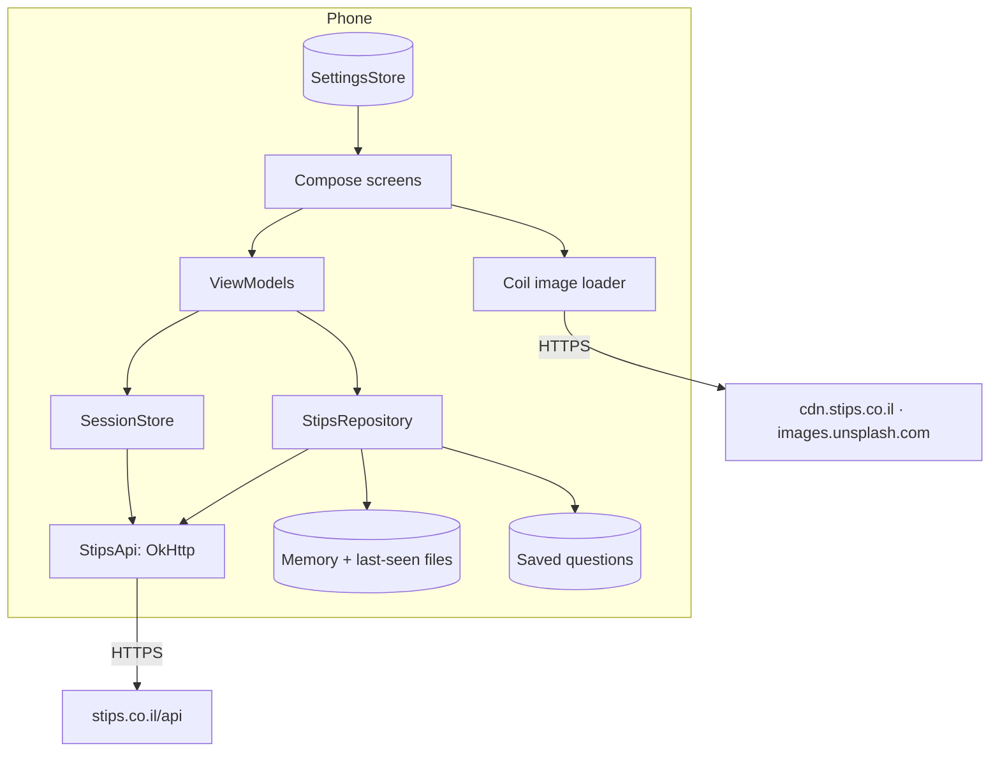

# SPEC-03: Architecture

## 1. Overview

No server of ours. Every request goes from the phone straight to Stips, like a browser.

## 2. Tech stack

Versions come from Google's CI-tested [compose-samples](https://github.com/android/compose-samples) catalog (`JetNews`, Nov 2026), whose `main` builds green (D-12).

| Part | Choice | Version |
|---|---|---|
| Build | Gradle (installed by CI, no wrapper yet) | 9.5.0 |
| Android Gradle Plugin | Built-in Kotlin (no `kotlin-android` plugin) | 9.3.1 |
| Kotlin + Compose compiler plugin | | 2.4.20 |
| JDK (CI) | Temurin | 17 |
| SDK | min 26 · target 36 · compile 37 | |
| Compose BOM | → Compose 1.12.1, Material 3 1.4.0, icons 1.7.8 | 2026.09.00 |
| Activity Compose | `enableEdgeToEdge`, back handling | 1.13.0 |
| Core KTX | | 1.19.0 |
| Lifecycle (ViewModel, runtime Compose) | | 2.11.0 |
| Navigation Compose | String routes | 2.10.1 |
| Coroutines | | 1.11.0 |
| kotlinx-serialization-json | `JsonElement` API only, no compiler plugin | 1.11.0 |
| OkHttp | HTTP/2, gzip, cookies | 4.12.0 |
| Coil (Compose) | Images, memory + disk cache | 2.7.0 |
| Glance (app widget, Material 3 colors) | The home-screen widget. It brings WorkManager 2.7.1 and Room 2.2.5, which start with every process | 1.2.0 |
| JUnit | Unit tests | 4.13.2 |

Signatures used from Navigation 2.10.1, Material 3 1.4.0 and Coil 2.7.0 were checked in their published source jars before writing code (playbook §4).

**Shrinking (R8):** release builds are shrunk but not obfuscated (`-dontobfuscate`, readable stack traces). AGP 9's R8 no longer keeps a class's default constructor for library rules written as `-keep class X`; WorkManager and Room write theirs that way, so `proguard-rules.pro` keeps those constructors and `gradle.properties` sets `android.r8.strictFullModeForKeepRules=false` (#7, D-55). CI's `tools/check_apk.py` fails the build if a class that a library creates by name (Room databases, WorkManager input mergers and workers, start-up initializers, Glance action callbacks) lost its constructor.

## 3. Packages (one module, `app`)

| Package | Contents |
|---|---|
| `…betterstips` | `StipsApp` (Application), `AppContainer` (manual dependency container), `MainActivity` |
| `….data.api` | `StipsApi` (requests, envelope, errors, the `+` quirk), `ApiException` |
| `….data.parse` | `Parsers`: tolerant JSON → models (pure, unit-tested) |
| `….data.model` | `Question`, `Answer`, `Author`, `Channel`, `Conversation`, `ChatMessage`, `UserProfile`, `ProfilePage`, `ChartPoint`, `ThanksMessage`, `StipsNotification`, `UnreadCounts`, `FeedQuery` |
| `….data` | `StipsRepository`, `SessionStore`, `SavedStore`, `SettingsStore`, `FeedCache`, `Timings` |
| `….ui` | `AppRoot` (scaffold, bottom bar, nav host), `Routes` |
| `….ui.theme` | `Theme`, `SchemeGenerator` (pure), `Type` |
| `….ui.components` | Cover/monogram, avatar (with the online dot: `PresenceAvatar`), question row, states (empty, error, skeleton), linkified text |
| `….ui.home`, `.question`, `.feed`, `.chats`, `.profile`, `.user`, `.notifications`, `.signin`, `.settings` | Screens and their ViewModels |
| `….notify` | `Notifier` (channels, posting, scheduling, status), `NotificationCheckJob` (JobScheduler, every 15 min) and `NotificationAlarmReceiver` (every few minutes while the phone is awake, v0.11); opt-in |
| `….widget` | The "Hot right now" widget: `HotWidget` (Glance UI), `HotWidgetReceiver`, `RefreshHotWidget` (⟳), `HotWidgetFeed` (its list and refresh rules). The chats widget: `ChatsWidget`, `ChatsWidgetReceiver`, `RefreshChatsWidget`, `ChatsWidgetFeed` (D-67) |
| `….diag` | `NetLog`: the in-memory network log (#3) |
| `….ui.ask`, `.penpals` | Asking a question; the pen-pals board |
| `….util` | Time parsing and relative formatting, answer validation and display order, Stips' caret replies (`ReplyRefs`), where notifications open (`JumpRules`), which notifications and chats reach the phone (`NotifyRules`, v0.11), links and deep links, launcher shortcut actions, HTML-to-text, Hebrew spans (pure); `ImagePrep` (profile photo: EXIF upright, square, JPEG) |
| `….crash` | Crash catcher |

## 4. UI layer

- **Single activity**, Compose only, edge-to-edge, `enableOnBackInvokedCallback` for predictive back.
- **Navigation Compose** with string routes: `home`, `chats`, `profile`, `question/{id}?focus=&count=&at=` (where a notification opens it, D-70), `user/{id}`, `notifications`, `hot`, `topic/{name}`, `conversation/{userId}?name=`, `mylist/{kind}`, `saved`, `signin`, `settings`, `settings/{page}`. The start destination is the chosen start tab, read once per launch (D-61). Custom enter/exit and predictive-back transitions (SPEC-02 §4).
- **App-wide state through composition locals:** `LocalOpenProfile` (any name or avatar opens a profile), `LocalUnreadCounts` (badges) and `LocalNow` (the ticking clock while *Count the seconds* is on, D-65), provided by `AppRoot`, which polls `messages.count` every 10 s while the app is started and signed in (D-25, D-53).
- **Welcome:** `AppRoot` draws `WelcomeScreen` over the scaffold on a fresh install's first launch, until sign-in or *Continue as a guest* (D-61); the app below stays composed so links can open into it, and is hidden from accessibility meanwhile.
- **Deep links:** `MainActivity` turns its intent (launch or `onNewIntent`) into a pending `DeepLink` (question, profile, messages, one chat, or the Hot list) that `AppRoot` navigates to once. Stips links come in as the intent's data; launcher shortcuts (`res/xml/shortcuts.xml`, D-57) as its action, mapped by `Shortcuts.link`; the chats widget's rows as the private `…action.CHAT` with a `stipsplus://chat/<userId>?name=` address (unique per chat); a phone notification's question also carries where to open it (`…extra.FOCUS`, `FOCUS_COUNT`, `FOCUS_AT`, D-70). Opening Hot or Chats reports the matching shortcut as used (`ShortcutManagerCompat.reportShortcutUsed`).
- **ViewModels** expose `StateFlow<UiState>`; screens collect with `collectAsStateWithLifecycle`. Factories come from `AppContainer` (no DI framework).
- **Theme** reads `SettingsStore`: dynamic color → else a generated scheme from the accent; dark/light/system; pure black. A `ChannelTheme` wrapper re-themes a subtree with a channel's scheme.

## 5. Core subsystems

| Subsystem | How it works |
|---|---|
| `StipsApi` | Builds `name` + JSON params; replaces `+` with `~MODU_PLUS_SIGN~`; GET for reads, form POST for writes and sign-in; parses the envelope; maps failures to `ApiException(code, message)` (429 → `RATE_LIMITED`, 403 → `BLOCKED`, 5xx → `SERVER`); tags each request with its method name for the log; drops idle connections after a network error; runs on `Dispatchers.IO`. Each answer's `Date` header feeds `ServerClock` (D-65) |
| HTTP clients | **API: HTTP/2** on one connection (D-48), with the cookie jar and the site's Referer (D-49); 10 s connect / 20 s read / 30 s call timeouts. **Images (Coil): a separate client** (own connection pool, HTTP/2, no cookies). Both log through `NetLogListener`. A `ConnectivityManager` default-network callback logs changes and drops idle connections (D-36) |
| `RateGuard` | A request budget (40 at once, then 30 a minute) that automatic checks (Live, badges, an open chat, phone notifications, the widget) yield to, and a pause with one try a minute when Stips refuses (D-46) |
| `BlockStore`, `AnonymousAnswers`, `SeenNotifications` | Local lists: hidden items/users (D-42), questions answered anonymously (D-43), the newest notification seen in the app per account |
| Cookies | An in-memory `CookieJar` for the ASP session. Restarted apps restore the session with `user.login {auth_token}` |
| `SessionStore` | Sign-in (`user.login` with email + password by POST) → keeps `a_token`, user id, nickname, gender in app-private prefs. When the first screen opens (not for background work, D-52), restores once in the background. After 10 idle minutes it checks the server session with `user.get_app_user` and signs in again with the token if needed; at most once per 30 s when Stips says "not signed in". Only `{"logged": false}` signs the user out (D-37). Sign out clears prefs and cookies |
| `StipsRepository` | Feeds, question, answers, channels (asset snapshot + live refresh), answer posting/editing/detaching, votes, pins, follow, profiles (page, graphs, flowered answers, thanks wall), notifications and unread counts, safe mode, bio, profile photo upload, chats. Memory cache for questions and answers already shown |
| `Notifier` | Opt-in. `JobScheduler` runs `NotificationCheckJob` every 15 minutes with any network (persisted across reboots; id 2104201000, far from WorkManager's own ids, D-72), and an inexact `ELAPSED_REALTIME` alarm runs `NotificationAlarmReceiver` every 1, 2 or 5 minutes while the phone is awake (each check sets the next; the job restarts the chain). Checks wait while the app is on screen (`MainActivity` sets `appVisible`) or the budget is low, and never overlap (a mutex). A check asks `messages.count`; it reads the notifications list when some are waiting, and the chats list when the unread count changed (or every 30 minutes); `NotifyRules` decides what's new by signature (D-73). Up to 5 notifications and 4 chats per check, in the *Answers and activity* and *Messages* channels (high importance). The first check after turning it on only records. The last check's result and time go to prefs for Settings (D-74) |
| `FeedCache` | Saves the first page of each list as JSON in app files; shown at once on the next launch, and by the widget |
| `HotWidgetFeed` | The widget's list: the first Hot page (now). Any screen that loads it updates the widget through `StipsRepository.onFirstPage`; by itself the widget asks Stips only when Android wakes it (hourly), its copy is over 30 minutes old and `RateGuard` allows; ⟳ always asks. One refresh at a time (D-51) |
| `ChatsWidgetFeed` | The chats widget's list: the first page of chats, from `StipsRepository.onConversations` (any screen that loads it). It watches `onUnreadCounts` and, only while a chats widget is placed, asks again when the count changes; also hourly when stale, and on ⟳; within `RateGuard`. Saved to `files/chats_widget.json` with the account's id; cleared on sign-out or another account (D-67) |
| `ServerClock` | The phone clock's offset from Stips', from answers' `Date` headers; applied only at 2 s or more. Feeds every "how long ago" (D-65) |
| `HomeSectionsViewModel` | The website-like Home: `feed.get` pages with one `random_order_number` per visit, personal (`userRelated`) then everyone's (`todayItems`) when empty; pages merged by heading (D-59) |
| `QuestionViewModel` (v0.10) | Easy reply: the reply target, the pointer written into the draft (`ReplyRefs`), its target remembered after posting (`ReplyTargets`), and the after-post correction by edit (D-68). Where a notification opens (`JumpRules`, with the last visit's `ReadMarks`, D-70). A queue of moderator lookups for answerers on screen, paced and capped (D-71) |
| `ReadMarks`, `ReplyTargets`, `UserBadges` | Small stores in prefs: the newest answer shown per question (500), each easy reply's target (300), people's profile badges with a moderator's gender (3,000, two weeks; `version` redraws the marks) |
| `SavedStore` | Saved questions (id, title, cover, time) in prefs as JSON |
| `SettingsStore` | SharedPreferences exposed as `StateFlow` |
| `Timings` | Records load durations (feed page, question) for the "Loaded in" line and Settings → Diagnostics, both shown only in expert mode (D-62) |
| Crash catcher | Default uncaught-exception handler writes `crash.txt` (version, device, stack trace), then defers to the system handler. Installed in `StipsApp.attachBaseContext`, before the libraries' start-up providers run (#7). The next launch shows the dialog |

## 6. Data layer

| Store | What | Where |
|---|---|---|
| `session` prefs | `a_token`, user id, nickname, gender | App-private, excluded from backup |
| `settings` prefs | Theme, colors, images, animations, Live, phone notifications; v0.9: Home's layout and options, start tab, order of answers, seconds, expert mode, whether the welcome was answered; v0.11: how often to check, whether the notifications offer was answered, whether to hide reply carets | App-private |
| `notify` prefs | What the checks have seen (v0.11: each notification's signature, each unread chat's newest message, the unread count), the last check's result, and when Android last ran one | App-private, cleared when turned off |
| `saved` prefs | Saved questions | App-private |
| `files/feed-*.json` | Last-seen first page | App-private |
| `files/chats_widget.json` | The chats widget's copy of your latest chats (D-67) | App-private, excluded from backup, deleted on sign-out |
| `read_marks`, `reply_targets`, `user_badges` prefs | The newest answer shown per question; easy replies' targets; answerers' badges (v0.10, D-68, D-70, D-71) | App-private; ids and badge names only |
| `files/crash.txt` | Last crash | App-private, deleted after the dialog |
| Coil disk cache | Images | App cache dir, 64 MB |

## 7. Platform integrations

- `ACTION_SEND` for sharing links; `ACTION_VIEW` for the site, sign-up and password reset.
- Intent filter for `https://stips.co.il/ask/…`, `/profile/…` and `/messages` (no `autoVerify`; users enable it under *Open by default*).
- `POST_NOTIFICATIONS` (asked only when the user turns phone notifications on), `RECEIVE_BOOT_COMPLETED` (keeps the persisted job) and `REQUEST_IGNORE_BATTERY_OPTIMIZATIONS` (Android's own "let Stips+ run in the background?" dialog, v0.11). The photo picker (`PickVisualMedia`) needs no storage permission.
- System splash (Android 12+) from the window background; adaptive + themed (monochrome) launcher icon of our own (no Stips logo).
- Static launcher shortcuts *Hot* and *Chats* (`res/xml/shortcuts.xml`, D-57), with adaptive icons.
- Two Glance app widgets: "Hot right now" (D-51) and the chats widget (D-67), each with a pin request from Settings.

## 8. Permissions

| Permission | Why |
|---|---|
| `INTERNET` | Talk to Stips and load images |
| `ACCESS_NETWORK_STATE` | Notice network changes (#3); JobScheduler needs it for a job that waits for a network (#1, #2) |
| `POST_NOTIFICATIONS` | Phone notifications, asked when the user turns them on (v0.2) |
| `RECEIVE_BOOT_COMPLETED` | Keeps the notification job after a restart |
| `REQUEST_IGNORE_BATTERY_OPTIMIZATIONS` | Shows Android's own question, "let Stips+ always run in the background?", so notification checks aren't held back for hours (v0.11, D-72). The user decides; nothing changes without that dialog |

Nothing else: no location, contacts or storage.

## 9. Networking and security

- HTTPS only (`usesCleartextTraffic=false`).
- The password is sent once, by POST in the request body, to `https://stips.co.il/api`; it's never written to disk or logs.
- The session token is stored app-private and excluded from cloud backup and device transfer (`dataExtractionRules`, `fullBackupContent`).
- User-Agent: `StipsPlus/<version> (Android <release>; unofficial; +https://github.com/EyalShimshi/better-stips)`.
- No logging of request bodies. No third-party SDKs.
- Hidden profile fields the API returns (for example birth dates) are never shown or stored; only the signed-in user's own gender is kept, to pick the anonymous nickname as the site does.

## 10. Distribution constraints

- Sideloaded APKs from the private repo's releases; Play Store only with Stips' permission (and Play's impersonation/IP policies).
- One signing key for every build (SPEC-05 §4).

## 11. Technical spikes (verify on the owner's device)

| ID | Question | How we'll know |
|---|---|---|
| S-01 | Does `user.login` return `a_token` and `appUser.id` as the web code expects? | Sign-in succeeds; Profile shows the nickname |
| S-02 | Does `user.login {auth_token}` restore the session after a restart? | Kill the app, reopen: still signed in, answering works |
| S-03 | Does `omniobj PUT ans` post an answer and return `newid`? | The answer appears on the site too |
| S-04 | Message list and thread shapes (`messages.list`, `messages.from_user`) | Conversations show names and last messages |
| S-05 | `item.vote` toggling | The score matches the site after a refresh |
| S-06 | Hebrew strings from `values-iw` on the owner's phone | The UI is Hebrew and right-to-left |
