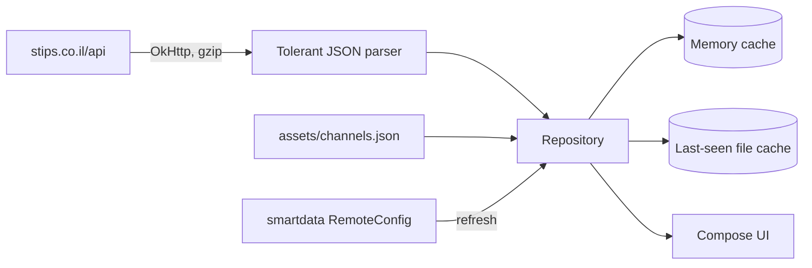

# SPEC-04: Data

*Where the content comes from, what it looks like, and how the app handles it. Everything in §2 was measured against the live service on 2026-11-02; re-check it when something breaks (§5).*

## 1. Source evaluation

| Source | What it gives | Access | Terms | Verdict |
|---|---|---|---|---|
| `https://stips.co.il/api` (the site's own JSON API) | Questions, answers, channels, topics, profiles, notifications, messages | HTTPS. Reads work without an account; writes need a signed-in session cookie | No public API, docs or license. Site terms apply (§6) | **Use.** The only source. It's the same API the website and the official app call |
| Official app `com.stipsapp` | A Cordova wrapper around the same website (`window.plugins.socialsharing` in the web bundle) | Google Play | — | Not a data source. A reference for features and pain points |
| `https://cdn.stips.co.il` | User-uploaded question photos and profile photos (JPEG) | Anonymous HTTPS | Stips and its users | **Use** for artwork and avatars |
| `https://images.unsplash.com` | Stock cover photos that askers pick for their question | Anonymous HTTPS | Unsplash License: free to use; credit the photographer | **Use**, with the photographer's credit on the question screen |
| HTML scraping, search engines | — | — | — | **Not needed.** The site is a single-page app; the API returns clean JSON |

## 2. API reference

### 2.1 Request format

- **One endpoint:** `https://stips.co.il/api`, GET with query parameters:

| Parameter | Value |
|---|---|
| `name` | The call: `objectlist`, `omniobj`, `homepage.content`, `smartdata.get`, `user.login`, … |
| `api_params` | A JSON object, serialized to a string |
| `rest_action` | For `omniobj` only: `GET` · `PUT` · `POST` · `DELETE` |
| `omniobj` | For `omniobj` only: `{"objType":"…","data":{…}}` as a string |

- **The plus-sign quirk:** the server decodes `+` as a space, so the web app replaces every `+` inside the JSON strings with `~MODU_PLUS_SIGN~`. The app must do the same. *Verified:* topic `C++` returns C++ questions only when encoded this way.
- **Writes** (the web app's rule): POST the same fields as a form body when `rest_action` is `PUT`/`POST`, or when the JSON is longer than 200 characters.
- **Session:** a classic ASP cookie (`ASPSESSIONID…`). The web app restores a signed-in session at start-up by calling `user.login` with `auth_token` (kept in the browser's localStorage under a key ending in `UserService.appUser_a_token`).
- **No special headers** are needed. Responses are gzip-compressed JSON, labeled `text/html; Charset=UTF-8`, behind Cloudflare (`cf-cache-status: DYNAMIC`, not cached).

### 2.2 Response envelope

```json
{ "status": "ok", "error_code": "", "error_msg": "", "data": …, "exec_time": "297ms", "sqls": [ … ] }
```

| `error_code` | Meaning |
|---|---|
| `API_ERROR_GENERAL` | Generic failure; `error_msg` is Hebrew text (for example, missing permission) |
| `API_ERROR_EOF` | The item doesn't exist (deleted question) |
| `API_ERROR_BANNED` | The signed-in user is banned |

### 2.3 Calls

**Read calls (no account needed), all verified:**

| Purpose | `name` | `api_params` / `omniobj` | Returns |
|---|---|---|---|
| Newest questions | `objectlist` | `{"method":"ask.new","page":1}` | `data`: array of 30 questions. An empty array means the end |
| Hot questions | `objectlist` | `{"method":"ask.hot","page":1,"filter_section_name":"now"}` (`now` · `today` · `week`) | Same |
| A channel | `objectlist` | `{"method":"ask.new","channel":"לימודים","page":1}`; hot adds `"filter_section_name":"week"` (`week` · `month`) | Same, all from that channel. **The channel is passed by its Hebrew name**, not its id |
| A topic (tag) | `objectlist` | `{"method":"ask.new","topic":"מתמטיקה","page":1}`; hot as for channels | Same |
| Pinned questions | `homepage.content` | — | `data.pinnedItems`: 5 questions |
| The website's home sections | `feed.get` | `{"page":1,"random_order_number":1309,"feed_type":"userRelated","extra_time":false}` (`todayItems` when signed out, or when `userRelated` is empty) | `data.results`: sections `{elementType, name, title, items}`; about 11 on page 1. A `topic` section shows `name` and links to the topic; an `itemList` shows `title`. 1–5 questions each (§2.11) |
| One question | `omniobj` | `rest_action=GET`, `omniobj={"objType":"ask","data":{"id":19745077}}` | `data.omniOmniObj`: one question |
| Its answers | `objectlist` | `{"method":"ans.for_item","askid":19745077}` | `data`: all answers at once (no paging) |
| Channels | `smartdata.get` | `{"namespace":"item","unit":"RemoteConfig"}` | `data.results.itemChannels.channels` |

**Not available:** a free-text search over questions. The web app's `search_query` parameter is ignored by `ask.new`/`ask.hot` (it's used only in an admin screen). Topics (tags) are the closest thing.

**Write and account calls (seen in the web bundle, not yet called; verify in the sign-in round):**

| Purpose | `name` | Parameters seen |
|---|---|---|
| Sign in / restore session | `user.login` | `email`, `password`, `auth_token`, `auth_cookie_password` |
| Who am I | `user.get_app_user` | — (fails with `API_ERROR_GENERAL` when signed out). `appUser{id, points, flowersCount, gender ("male"/"female"), safeFilter, moderator ("regular"·"senior"·"admin"), ban{banned, msg (HTML), endDateText}, permissions, phoneNotValidated}`; read for the account since v0.13 (§2.13) |
| Vote on an answer | `item.vote` | `objType`, `id`, `vote` (1, 0, −1) |
| Give a flower (best answer) | `item.send_flower` | — |
| Post an answer | `omniobj` (create) | `objType:"ans"`, `data:{askid, a, name, anonflg, link1, link1name}` |
| Ask a question | `omniobj` (create) | `objType:"ask"`, `data:{q, text_content, tagslist, photo, anonflg, name, ask_type:11, channel_id}` |
| My questions / answers / pins | `objectlist` | `{"method":"ask.user_activity","for_current_user":true,"filter_section_name":"asked"}` (`asked` · `ansed` · `pinned`) |
| Notifications | `notifications.list` | — |
| Private messages | `messages.list`, `messages.from_user`, `messages.send`, `messages.count` | `page`, `userid`, `msgid` |
| Profile | `profile.page_data` | — |
| Report | `reports.send` | — |

**Account calls used since v0.2** (read in the web bundle and watched on the site with the owner's account, D-22; write calls were watched, not sent, unless noted):

| Purpose | `name` | Parameters | Returns / notes |
|---|---|---|---|
| A user | `omniobj` GET | `{"objType":"user","data":{"id":…}}` | `data.points` (credibility 0–100), `data.gender` (1 male, 2 female), `extra.photostamp`, `extra.item_profile.online` |
| Profile page | `profile.page_data` | `{"userid":…}` | `questions`, `answers`, `flowers`, `age`, `hebrew_active_since` ("6 שנים ו-9 חודשים"), `badges[{name}]`, `user_profile_page.data.text_status` (bio), `user_profile_page.meta.permissions.edit`; older profiles: `profile_quote` |
| Activity graph | `profile.actions_chart` | `{"userid":…,"action":"ans"}` (`ans` · `ask` · `flowers`) | `chartData[{time:"2026/10/25 00:00:00", actionsCount}]`: 26 weekly points, newest first |
| Answers that got a flower | `objectlist` | `{"method":"ans.flower_for_user","userid":…,"page":1}` | Answers with `extra.parent_item_title` |
| Earlier versions (v0.13, #10) | `objectlist` | `{"method":"omniobj_revision.for_item","itemid":…,"itemObjType":"ans"}` (or `"ask"`) | Not paged, newest first: `objType: "omniobj_revision"`, `data{jsonstring (the fields the next edit changed, as they were before it), editor ("owner"·"moderator"·"platformAdmin")}`, `extra{hebrew_time, item_profile}`. Only items with `data.revision_flg` have any; the site says "אין גרסאות קודמות לפריט זה" otherwise, and fills the rest of each version from the current item |
| Thanks wall | `objectlist` | `{"objType":"thanksmsg","userid":…,"page":1}` | 30 per page: `data{id, fromuserid, touserid, msg, time}`, `extra.item_profile` (the writer), `meta.permissions.deleteWithoutMsg` (the wall's owner) |
| Delete a thanks message | `omniobj` DELETE | `{"objType":"thanksmsg","data":{"id":…}}` | — |
| Notifications | `notifications.list` | `{"page":1}` | `[{id, contentHtml, msgText, pointsRemoved, linkPageName ("ask"·"profile"), linkItemId, viewed, time, type}]`; types are words like `new_ask_ans_registered`, `new_flower`. The site always shows `contentHtml`, and `msgText` (the team's words) in a box under it, with "הופחתו N נקודות אמינות" when `pointsRemoved` > 0 (§2.13). Listing marks them seen for the whole account (§2.15) |
| Unread counts | `messages.count` | `{}` | `{messagesCount, notificationsCount}` |
| Pin / unpin | `item.add_pin` | `{"id":…,"minus":false}` (`true` unpins) | The question's `data.user_pinned` is 1 when pinned (−1 when never pinned); pinned list: `ask.user_activity` with `pinned`. *Sent once by mistake during research and undone at once* |
| Is following | `smartdata.get` | `{"namespace":"ask","unit":"AskAdditionalData","id":…}` | `results.notificationsRegistered` |
| Follow / unfollow | `item.notifications_register` | `{"objType":"ask","id":…,"add":true}` | The site does this after an answer when its "קבלת עדכונים" toggle is on (the default) |
| Edit an answer | `omniobj` POST (`rest_action`) | `{"objType":"ans","data":{"id", "a", "link1", "link1name"}}` | Only while the answer's `meta.permissions.edit` is true (it expires) |
| Detach an answer from your account | `item.set_anonymous` | `{"objType":"ans","id":…}` | Offered when `meta.permissions.itemOwner`; the site confirms first |
| A link's title | `smartdata.get` | `{"namespace":"utils","unit":"GetUrlMeta","url":…}` | `results.title` (may be empty); names the one link an answer can carry (`link1`, `link1name`) |
| Safe mode | `user.update.settings` | `{"userid":…,"settings_name":"safeFilter","value":true}` | Stored on the account |
| Bio | `omniobj` POST | `{"objType":"user_profile_page","data":{"userid","text_status"}}` with `api_params {"createIfNotExist":true}` | — |
| Profile photo | multipart POST to `https://stips.co.il/scripts/upload/photo.asp?photo_type=profile_photo` (field `file`), then `profile.set_thumbnail` | `{"userid","x0","x1","y0","y1"}` (the crop square) | Upload answers `{success, error}`. The site adds `&flip=yes` / `&rotateR=yes` for camera photos; the app straightens the photo itself |

Credibility bands on the site's gauge ("דירוג אמינות"): 0 red `#f50057`, 30 yellow `#FDD835`, 50 indigo `#3f51b5`, 80 green `#09c286`. Badge codes: `moderator` (נאמן/ת סטיפס), `senior_moderator` (נאמן/ה בכיר/ה), `old_expert` (מומחה/ית סטיפס), `senior_advisor` (עונה בכיר/ה), `custom_rank`.


**Calls used since v0.3** (from the site's code, checked live where public; write calls not sent during research):

| Purpose | `name` | Parameters | Returns / notes |
|---|---|---|---|
| Report | `reports.send` | `{"itemid","itemtype":"ask"/"ans"/"penfriendsitem","reason","reason_id":0}` | The user's words, 5–500 characters. Users are reported from chats (v0.8) with `itemtype:"usermsgs"`, `itemid` = their id, `reason_id` 2 (spam or ads), 4 (sexual offers), 8 (cursing, insults), 16 (suspicious questions about personal details) or 1024 (other), and optional details in `reason`; the site shows the details box after a reason is picked |
| Block content | `smartdata.get` | `{"namespace":"ask","unit":"BlockContent","id","objType","blockUser"?:true}` | Answer ignored. Hiding is done by the client; the site's app keeps `bc-item-{type}-{id}` / `bc-user-{id}` flags locally, and "remove all" just clears them |
| Block messages | `messages.block_user` | `{"userid","action":"add"/"remove"}` | Answer ignored by the site. The first page of `messages.from_user` returns `userBlocked` (true: you blocked them); the site then hides the chat and offers to unblock |
| Delete your item | `omniobj` DELETE | `{"objType","data":{"id"}}` | When `meta.permissions.delete` or `deleteWithoutMsg` |
| Edit your question | `omniobj` POST | `{"objType":"ask","data":{"id","q","text_content","tagslist":[…],"q_link"}}` | When `meta.permissions.edit` |
| Detach your question | `item.set_anonymous` | `{"objType":"ask","id"}` | As for answers |
| Send a flower | `item.send_flower` | `{"id": answerId}` | `{flowerSent: true}`. Only the asker, to someone else's answer up to 14 days old, 5 per question; not to the asker's own reply (`extra.parentItemCreatorResponse`) |
| Write on a thanks wall | `omniobj` PUT | `{"objType":"thanksmsg","data":{"msg","touserid"}}` | — |
| Find people | `smartdata.get` | `{"namespace":"users","unit":"Search","q"}` | `results.profiles[{userid,nickname,photostamp,online,anonflg}]` (verified, public) |
| Daily question limit | `smartdata.get` | `{"namespace":"ask","unit":"DailyAskCount"}` | `results{allowed,maxPerDay}` |
| Tag suggestions | `item.autotags` / `item.tag_suggest` | `{"title"}` / `{"q"}` | `data.tags[]` (verified, public) |
| Cover photos | `photos.tag_gallery` | `{"tags":["…"]}` | `data.photos[{photo_id,original_url}]`; the site falls back to the tag "רקעי פריטים" |
| Ask | `omniobj` PUT | `{"objType":"ask","data":{"q","q_link","text_content","tagslist":[…],"photo","anonflg"?,"name"?,"ask_type":11,"channel_id"?}}` | `data.newid`. Title 10–120, details ≤2000, 1–5 tags, nickname 2–18; a photo unless the link is YouTube |
| Pen pals: list | `objectlist` | `{"method":"penfriendsitem.new","page"}` | 30 per page, newest first: `data{id,msg,time,active}`, `extra.item_profile` (verified, public) |
| Pen pals: may I post? | `smartdata.get` | `{"namespace":"penfriends","unit":"PostAllowed"}` | `results{allowed,postInterval,nextTimeInMinutes}`. Posting also needs 5 flowers (`user.get_app_user` → `flowersCount`) |
| Pen pals: my last post | `smartdata.get` | `{"namespace":"penfriends","unit":"LastMessageForUser"}` | `results.messageText` |
| Pen pals: post | `omniobj` PUT | `{"objType":"penfriendsitem","data":{"msg"}}` | Up to 255 characters; ages 13–21 (the site's rule) |

**Chats, as the site's chat screen calls them** (read in the web bundle for v0.7, #6):

| Purpose | `name` | Parameters | Returns / notes |
|---|---|---|---|
| Open a chat | `messages.from_user` | `{"userid","msgid":0,"first_load":true}` | `messages[{id,msg,time,fromuserid,touserid}]`, the newest page; `userBlocked` |
| New messages | `messages.from_user` | `{"userid","msgid":<the last id>,"first_load":false}` | Only messages after that id. The site asks every 1.6 s while a chat is open (`syncTime`); Stips+ every 3 s (D-53) |
| Earlier messages | `messages.from_user` | `{"userid","msgid":<the first id>,"history":true}` (the site adds `"first_load":false`) | The page before that message, empty at the start. The site asks when the list is scrolled within 300 px of its top |
| The chats list | `messages.list` | `{"page"}` | One row per person; `itemProfile{userid,nickname,photostamp,online}`. A page at a time: page 1 held 29 chats for the owner and about 34 for a friend (build 29); the site asks for the next page as its list's end comes into view, stops at an empty one, and merges chats by `fromtokey` (a page can repeat a chat that moved). The site reloads page 1 every 5 s while it's open |
| Send | `messages.send` | `{"touserid","msg"}` | `{newid}`; the site treats a reply without it as a failure |
| Who's in the chat | `omniobj` GET user | As "A user" above | The site's chat header shows the photo, the name and `online` |

**Sessions and errors (measured in v0.3):**
- Account calls made without a live session return `status: "ok"` with **empty data** (`messages.count` → 0/0, `notifications.list` → `[]`, `AskAdditionalData` → false). Only `user.get_app_user` fails, with "המשתמש אינו מחובר למערכת".
- `user.login` with a token Stips no longer accepts returns `{"status":"ok","data":{"logged":false}}`.
- Stips is served through **Cloudflare** (`Server: cloudflare`, `CF-RAY`) from one ASP.NET origin (one `ASPSESSIONID…` cookie name across requests). A Cloudflare limit shows as HTTP 429 or 403.
- **A call without the session cookie gets a new anonymous session cookie** (#9, v0.12). A feed call sent before the sign-in, answered after it, therefore replaced the signed-in cookie, and account calls came back empty: in the owner's log `messages.list` went from 2 KB to 85 B a second after the sign-in, on the same connection. The app now ignores cookies from answers to calls that started before the latest sign-in (D-79).
- **Text is HTML-escaped** (v0.12): what people write comes back with `&lt;`, `&gt;`, `&amp;`, `&quot;` and numeric references, which the site decodes on display. Stips+ decodes it once in the parsers (D-77).

**Request limit:** Stips refuses an address that sends too many calls, with `IP_RATE_LIMIT` (§2.10).

**Image sizes (measured):** question photos `s` (75×75), `w400`, `z` (about 500 px, the largest); Unsplash covers accept any `w=` (1080 used for full view); profile photos `t` (50×50), `a` (200×200, square crop), `l` (the whole upload, about 300×530).
### 2.4 Question (`objType: "ask"`)

| Field | Example | Use |
|---|---|---|
| `data.id` | `19745126` | Identity; links `https://stips.co.il/ask/<id>` |
| `data.q` | "איך התליון שלי?…" | Title (the question itself) |
| `data.text_content` | "https://www.reddit.com/…" | Body, plain text with `\n`; may contain URLs |
| `data.tagslist` | `["כסף","מחירים"]` | Topics |
| `data.time` | `2026/11/02 16:59:56` | Posted time, **Israel local time, no zone** |
| `data.anonflg` | `true` | Asked anonymously (no profile link) |
| `data.photo` | `4791385491` or `unsplash:StifWyrXbdc` | Cover image (§2.6) |
| `data.answer_count`, `data.pin_count` | `13`, `0` | Counts |
| `data.q_link` | `https://example.com/…` | A link the asker attached (shown under the title) |
| `data.user_pinned` | `1`, `0`, `-1` | 1 = pinned by the signed-in user |
| `data.channel_id` | `4` | `0` = no channel |
| `extra.hebrew_time` | "33 שניות" | The server's relative time (Hebrew only; the app formats its own) |
| `extra.url` | `ask/19745126/<slug>` | Share link path |
| `extra.content_image` | `url_small`, `url_medium`, `creator_name`, `creator_username` | Unsplash cover and credit |
| `extra.item_profile` | `nickname`, `userid`, `photostamp`, `online`, `anonflg` | The asker |
| `meta.permissions` | `edit`, `delete`, `report`, … | What the current user may do |

### 2.5 Answer (`objType: "ans"`)

| Field | Use |
|---|---|
| `data.id`, `data.askid` | Identity, parent question |
| `data.a` | Text, plain with `\n` |
| `data.name`, `data.anonflg` | Display name; anonymous answers carry a chosen nickname (for example "אנונימית") |
| `data.time` | Israel local time |
| `data.votes_score`, `data.votes_count` | Score |
| `data.link1…3`, `data.link1name…3name` | Optional links |
| `extra.userVote` | The current user's vote |
| `extra.flowered` | Picked as a best answer (a "flower") |
| `extra.item_profile` | The answerer |
| `extra.parent_item_title` | The question's title (in lists of a user's answers) |
| `extra.parentItemCreatorResponse` | The asker wrote this answer; the site labels it "שואל השאלה:" ("שואלת השאלה:" when the nickname is "אנונימית") |
| `meta.permissions.edit`, `meta.permissions.itemOwner` | The signed-in user may edit it (time-limited) / wrote it |

### 2.6 Images

| Image | URL | Measured size |
|---|---|---|
| Question photo, thumbnail | `https://cdn.stips.co.il/photos/s/<photo>.jpg` | 3.6 KB |
| Question photo, 400 px wide | `https://cdn.stips.co.il/photos/w400/<photo>.jpg` | 35 KB |
| Question photo, large | `https://cdn.stips.co.il/photos/z/<photo>.jpg` | — |
| Unsplash cover | `extra.content_image.url_small` (400 px) / `url_medium` (680 px) | ~30–60 KB |
| Profile photo, small / large | `https://cdn.stips.co.il/photos/user_profile/t|l/<userid>/<photostamp>.jpg` | 4 KB / 115 KB |
| Channel icons | SVG on the site | **Not used:** Android can't decode SVG; the app uses its own icons |

A numeric `photo` is a Stips upload; `unsplash:<id>` means the cover is in `content_image`. A question with neither gets a generated monogram (DESIGN-PHILOSOPHY §2.8).

### 2.7 Channels (snapshot 2026-11-02)

| id | Name | Meaning | Site icon | Gradient (site) |
|---|---|---|---|---|
| 1 | מוסיקה | Music | `music` | `#ff5900 → #ffec27` |
| 2 | אינטרנט וטכנולוגיה | Internet and technology | `technology` | `#1697b1 → #00074e` |
| 4 | לימודים | Studies | `dna` | `#00b165 → #26c1f8` |
| 7 | סדרות וסרטים | Series and movies | `movies` | `#af00c9 → #a30606` |
| 8 | בעלי חיים | Animals | `animals` | `#7bd5fd → #3b58e3` |
| 9 | פילוסופיה | Philosophy | `philosophy` | `#800080 → #ea4fc9` |

The snapshot, with every channel's full gradient, ships as `app/src/main/assets/channels.json` (§4). Each channel's first strong color seeds its tinted scheme (DESIGN-PHILOSOPHY §2.2).

### 2.8 Measured costs and speed

| Request | Transfer (gzip) | Raw | Time |
|---|---|---|---|
| Feed page (30 questions) | 9.5 KB | 45 KB | 0.4–0.55 s |
| Answers (13) | 1.6 KB | 9.4 KB | 0.2 s |
| Channels config | < 1 KB | 1.4 KB | 0.1 s |

Browsing 100 questions with thumbnails costs roughly 0.5–1 MB; opening questions with large covers adds about 50 KB each.

Background costs (all opt-in or only while the app is open): **Live** reloads the first New page every 30 s by default (5 s at the fastest, ≈6.7 MB an hour) while Home is on screen, ≈120 × 9.5 KB ≈ 1.1 MB an hour. **Unread counts** cost under 1 KB every 10 s while the app is open (≈0.3 MB an hour at most). **An open chat** asks for new messages every 3 s (under 1 KB when nothing is new, ≈1 MB an hour) and for the other person's profile once a minute, only while it's on screen. **Phone notifications** cost one small check (under 1 KB) every 1–5 minutes while the phone is awake (2 by default; about 30 an hour of screen time) and about every 15 minutes otherwise, plus a list (a few KB) only when something may be new: a few MB a day at most for a heavy phone user, well under 1 MB on a quiet day. **The widget** asks for the first Hot page (≈9 KB) only when Android wakes it (hourly) and its copy is over 30 minutes old: at most 24 a day, ≈0.2 MB; nothing when the app loaded that list recently. **The chats widget**, while it's on the home screen, asks for the first page of chats (a few KB) when the unread count changes, or hourly when its copy is over 30 minutes old; nothing when the Chats screen loaded the list. **Counting the seconds** costs nothing. **Moderator marks** read the profile badges (about 1–2 KB) of people whose answers are on screen, once every two weeks per person, at most 30 per question visit, one every 1.5 s at most. **Easy reply** adds one edit when answers came in between.

### 2.10 Request limit (`IP_RATE_LIMIT`, #5)

- **What it looks like:** HTTP 200 with `{"status":"failed","error_code":"IP_RATE_LIMIT","msg":"ip <address> reached rate limit"}` (130 bytes), from Stips' server (`cf-cache-status: DYNAMIC`, no `cf-mitigated`), not from Cloudflare. Once it starts, calls from that address get it whatever the method, for 20 minutes or more. (The app reads `error_msg`, not `msg`, so the address never reaches its network log.)
- **Stips+ 0.3** was refused after about 100 calls in under 4 minutes (51 `objectlist`, 13 `omniobj`, 10 `smartdata.get`, 9 `profile.actions_chart`, 7 `messages.count`, 5 `profile.page_data` and a few others). Stips+ 0.2 (IPv4, #3) was cut off the same way, and only a new address (a VPN, airplane mode) brought it back.
- **The official app** is the site in a WebView: the same `https://stips.co.il/api` and parameters (GET, or a form POST over 200 characters). PCAPdroid recordings while refreshing frantically, one HTTP/2 connection each: 102 calls in 2 m 17 s, and 185–245 in 4 m 34 s; none were refused.
- **Since v0.5** Stips+ makes its calls the way the site's own pages do (D-49), with its honest User-Agent, and paces itself near the official app (40 at once, then 30 a minute: at most 190 in any 5 minutes, D-46). If Stips refuses anyway, it pauses and tries once a minute until Stips answers.
- **The site's profile graph** loads only the selected action (`ask`, `ans` or `flowers`) and reloads when the selection changes.
- The measurements behind these choices aren't published here (#14): they would show other clients how to get around Stips' limit.
### 2.11 Home sections, special accounts and the server's clock (#8, measured 2026-11)

- **`feed.get`** is the website's home below its five hot questions. `random_order_number` is computed by the page from the local (Israel) time: 1000 × the weekday (Sunday 0) + 100 × the hour + the minute / 5, so the order changes every five minutes; Stips+ keeps one number for all pages of a visit. Page 2 had 26 sections. A section's `items` are ordinary question objects (`objType: "ask"`). Sections can repeat a topic; Stips+ merges them.
- **`item_profile.specialConfig`** appears only on special accounts (absent, or an empty array, otherwise). Net Knights (user 253000): `{"profileBackground":"linear-gradient(135deg, #f64f59, #b45ae0, #109cbb)","profileLightColorNickname":true,"itemNicknameSpecialRankColor":true,"itemSpecialRankBranding":"RANK_NET_KNIGHT"}`. The site outlines `RANK_NET_KNIGHT` answers (`rgba(192,14,212,.3)`), animates highlighted nicknames between #5e5e5e and #9069d7, and sends `item.send_view` when such an answer is shown (Stips+ doesn't).
- **`profile.page_data`** may carry `hideAge: true` and `hideStats: true` (Net Knights), and `badges` entries `{"name":"custom_rank","label":"מגן מקוון"}` whose label is shown as is. Sahar volunteers (user 10486) have only a `senior_advisor` badge, with no special flag.
- **Stips' system account** answers as "מערכת סטיפס" with `item_profile.isPlatfromAdmin: true` (Stips' spelling) and `anonflg: true`; the site shows a system label instead of a profile link.
- **The server's clock:** every answer from Stips carries an HTTP `Date` header (to the second). Stips+ estimates the phone's offset from it and corrects times when it's 2 s or more (D-65).

### 2.12 Answers' order, their authors, and caret replies (v0.10, measured 2026-11-05)

A CI probe read 24 busy questions (26–151 answers each, 1,203 answers) and the profiles of their 70 most active answerers, anonymously.

- **Order:** `ans.for_item` returned every list in ascending answer id, which is posting time; flowered answers stay where they were posted. The site shows the list as returned, so "N answers up" counts in this order.
- **Fields:** `data`: `id, a, name, link, link1…3, link1name…3name, time, askid, anonflg, archive, super_anonflg, votes_count, votes_score, revision_flg`; `extra`: `userVote, flowered, hebrew_time, item_profile, parentItemCreatorResponse` (on 63); `meta`: `active, permissions{edit, delete, deleteWithoutMsg, ban, report, showAdminMsgs, itemOwner}`. `item_profile` is only `nickname, anonflg, active, userid, photostamp, online`: **no badges or rank**. The user object (`omniobj` user) has `active, gender, has_photo, id, nickname, photo_updated_stamp, points`, no badges either; only `profile.page_data` has them. Of the 70 answerers, 43 had `senior_advisor` ("עונה בכיר") and none `moderator`.
- **Caret replies:** 213 answers contained "^": 173 opened with a pointer, 25 had one further on, the rest were other carets. Forms seen: runs ("^", "^^^^^", eight at the end of a line), "^6" (straight before the words), "^3" at the end, "4^", pointers after punctuation ("…לגמרי.^^^"), stacked pointers ("^^^", newline, "^^", newline, text) and a second pointer opening a later paragraph. Pointers count the answers above in the order above. Stips+ reads and writes them as D-68 and D-69 describe.
- **Notifications** (`notifications.list`) link only to the question (`linkPageName: "ask"`, `linkItemId`), never to an answer, and the site opens them at the top. Their texts come from the server, so the count of new answers is read from the text when it says one (D-70).

### 2.13 The account, blocks and credibility (v0.13, from the site's code and Stips' rule book 3.2.0)

- **Blocks:** `appUser.ban.banned` marks a blocked account; `msg` is the reason (HTML) and `endDateText` the end, in Stips' words. The site checks every action first (`runIfAllowed`): a blocked account gets a dialog, "נחסמת זמנית מפעילות" / "סיבת החסימה:" / the reason / "סיום החסימה: " + the end (only the reason when there's no end), and the action doesn't run; reading stays open. A call refused for a block answers `API_ERROR_BANNED`, and the site then reads the app user again. Not seen yet: whether `ban` is left out or `{banned: false}` when not blocked (both are read as not blocked).
- **Minimum flowers:** sending a message (`MIN_FLOWERS_TO_SEND_MESSAGE`) and posting on pen pals (`MIN_FLOWERS_TO_ADD_PEN_FRIENDS_ITEM`) need 5 flowers, unless the user is a moderator; the site says "{action} למשתמשים בעלי 5 פרחים ומעלה. כרגע יש לך N פרחים. פרחים ניתן לקבל ממשתמשי סטיפס אחרים, בהוקרה על תשובה טובה שנתת להם.".
- **Credibility points** (the rule book, p. 9, and its table): 0–100. They drop when a moderator removes something that breaks the rules (anonymous posts too), by the moderator's judgment, and rise by themselves: a point every 3–7 days at 90–100 (*Perfect*), every 2 days at 70–89 (*Very reliable*), every day at 20–69 (*Reliable* 60–69, *Okay* 40–59, *Problematic* 30–39, *Harmful* 20–29), never at 0–19 (*Very harmful*). Below 50 questions and answers can't be edited (a moderator can fix a typo); editing is open for 2 days after posting. At 20–29 the account is blocked for 30 − points days ("23 is a week"); below 20, for good. Moderators can also block for 24 hours or more, delete, edit and leave notes.
- **Notifications** (the rule book, p. 10): new answers, flowers, thanks-wall messages, removals by the team and notes by the team. Their type names aren't in the site's code (only `new_flower`), so Stips+ tells the team's notices apart by `msgText`, `pointsRemoved` and their words (D-82).
- **Also in the rule book:** the senior answerer badge comes at 500 flowers; moderators are chosen from users aged 15+, with 100 points, 3,000+ flowers, a year and a half on the site and a year since their last block; 10 questions a day; flowers are removed with a deleted question or answer.

### 2.14 "Online", "active" and "on Stips for" (#19, from the site's code, 2026-11)

- **Online (the green ring):** Stips' server decides it and sends only `true` or `false`: `item_profile.online` on every question, answer and chat row; `extra.item_profile.online` on a user (`omniobj` user); `online` in people search and in the chats list (`itemProfile`). The site only copies it (`n.online = e.extra.item_profile.online`) and draws a pulsing green ring around the photo (`animation-profile-online`, 1.2 s); the chats page filters "online now" with it (`onlineFilterFlg`). No time and no "last seen" is ever sent, so the rule itself (how long after someone's last activity they stop counting as online) lives on Stips' server and can't be read from outside. A value is as fresh as the call that brought it: the site reloads the chats list every 5 s, and Stips+ reads the other person's profile once a minute in an open chat.
- **What makes someone online:** most likely any signed-in request (a page or an API call) in the last few minutes. *Not measured.* To check it: watch an account's dot from a second account while the first stays idle, then has it make one request. That would include Stips+'s own background checks: with phone notifications on, it asks for the unread counts every few minutes while the phone is awake, signed in, so Stips may show the user as online then.
- **`active` means two different things:**
  - `meta.active` on a question or an answer: whether it's still up. A moderator's removal brings it back `active: false` with the team's messages (`meta.adminMsgs`), which the site shows in its place (`showAdminMsgs`). Stips+ leaves such items out.
  - `active` in `item_profile` and on the user object: whether the account itself is active (not deleted or closed). The site's code reads it nowhere.
- **"On Stips for":** `hebrew_active_since` in `profile.page_data`, Stips' own phrase for the account's age ("6 שנים ו-9 חודשים"); Stips+ shows it on profiles.

### 2.15 The bell's "viewed", notes to self and emoji codes (v0.17)

- **"Viewed" belongs to the account, not to an app.** `notifications.list` returns each item's `viewed` as it was, then Stips counts the listed ones as seen: `messages.count`'s `notificationsCount` drops to 0, whoever listed them (the site's bell, the official app, Stips+). The site also zeroes its own badge after listing (`clearNotificationsCount`). Stips seems to update one notification per question while it's unseen ("3 new answers") and to start a new one once it was seen, so an account read by two apps gets a notification per burst. The owner, who also uses the official app, saw the bell's number missing and never got phone notifications about answers. So Stips+ keeps its own record (D-122, D-123): what the bell last showed, per account, and what a check found new and the bell hasn't shown ("waiting", with the row each goes in).
- **Notes to self:** `messages.send` with your own `touserid` works, and `messages.list` then lists the chat with yourself like any other: the owner sent themselves a message from Stips+ 0.16 (#23's network log: `messages.send` answered 200 with 91 B, and the next poll had nothing newer than the app's own copy). The site hides only its report button there (`userService.isId`). Its system account (999 in its settings, "מערכת סטיפס") has no composer at all (`systemServiceUserFlg`).
- **Emoji codes:** the site's chats drop `{ic:N}` (`removeOldEmojiCodes`) and turn `:name:` into pictures with EmojiOne 2.2.7 (`emojioneClient.toImage`, codes in lower case, no `:)` faces). Answers and pen pals don't. A message made only of emoji is drawn bigger on the site; Stips+ doesn't do that.

## 3. Data model (in the app)

```kotlin
data class Question(
    val id: Long, val title: String, val body: String, val topics: List<String>,
    val postedAt: Instant, val answerCount: Int, val pinCount: Int, val channelId: Int,
    val author: Author, val cover: Cover?, val sharePath: String,
)
data class Answer(
    val id: Long, val questionId: Long, val text: String, val postedAt: Instant,
    val score: Int, val flowered: Boolean, val author: Author, val links: List<Link>,
)
data class Author(val nickname: String, val userId: Long?, val photoStamp: String?, val anonymous: Boolean, val online: Boolean)
sealed interface Cover { data class Stips(val photoId: String) : Cover; data class Unsplash(val small: String, val medium: String, val credit: String) : Cover }
data class Channel(val id: Int, val name: String, val icon: String, val colors: List<Color>)
enum class Feed { New, Hot }   // with HotWindow: Now, Today, Week, Month
// v0.13: the signed-in account; counts Stips leaves out stay null, never 0
data class AppUser(val id: Long, val points: Int?, val flowers: Int?, val safeFilter: Boolean, val female: Boolean, val moderator: String?, val ban: AccountBan?)
data class AccountBan(val message: String?, val endsText: String?)   // temporary when endsText is set
data class UnreadMark(val id: Long, val count: Int)                   // the "unread" bar above an answer or message
```

- **The parser is tolerant:** a missing or mistyped field gets a safe default instead of failing the whole list. Ids may arrive as numbers or strings.
- **Times** are parsed as `Asia/Jerusalem` local time and shown relative in the user's language ("5 min", "לפני 5 דק׳").

## 4. Pipeline



- **Bundled snapshot:** `channels.json` makes the Channels screen instant and offline-ready. Unit tests validate it (ids unique, names non-empty, colors parse).
- **Cache what you've shown:** the last feed page of each list is saved to the app's private files, so the next launch shows it at once and refreshes quietly.
- **Updatable without a release:** at start-up the app refreshes channels from `smartdata.get` and keeps the snapshot as a fallback.

## 5. Automation and maintenance

- No server of our own, no background polling in v0.x.
- **When the site changes** (renamed calls, new fields): the parser tests (with recorded fixtures in `app/src/test/resources/`) show what still parses. Re-run the probes in MAINTAINING.md to compare.
- **Fixtures** are trimmed real responses with personal data replaced (nicknames → "משתמש/ת", user ids → 1000+).

## 6. Governance and legal

**Stips' terms of use** ([stips.co.il/about/terms](https://stips.co.il/about/terms), read 2026-11-02; the page renders only in a browser):

| Clause | Text (Hebrew) | Meaning for us |
|---|---|---|
| Operator | "האתר מנוהל ומופעל על-ידי נדב דפני - אינטרנט ותוכנה בע\"מ" | Who to ask (Google Play lists the developer as Futurebit Media Ltd., `contact@stips.co.il`) |
| Intellectual property | "אין להעתיק, לשכפל, להפיץ, למכור, לשווק ולתרגם מידע כלשהו לרבות סימני מסחר, תמונות, צילומים, טקסטים וקוד מחשב מן האתר בלא קבלת רשותה המפורשת של הנהלת האתר מראש ובכתב." | Copying or distributing content or trademarks needs **prior written permission** → private until Stips agrees (D-02) |
| Commercial use | "אין לעשות כל שימוש מסחרי במידע, בתכנים ובנתונים המתפרסמים באתר… בלא קבלת הסכמתה של הנהלת האתר מראש ובכתב." | The app is free, with no ads or payments |
| Automated access | "חל איסור חמור להפעיל כל יישום מחשב… לרבות תוכנות מסוג Crawlers, Robots וכדומה, שנועדו לשם חיפוש סריקה, העתקה או אחזור באופן אוטומטי של מידע ותכנים מהאתר לשם יצירת העתק, מלא או חלקי…" | No crawling, mirroring, bulk prefetch or export. The app fetches only what the user opens, like a browser (D-13) |
| User content | Users grant Stips a free, worldwide, perpetual license to what they post | Answers posted through the app are ordinary Stips posts |
| Law | Israeli law; courts in Jerusalem and Tel Aviv | — |

**Other sources:**
- `robots.txt` allows everything except one profile page.
- Unsplash photos: free under the Unsplash License; the app shows the photographer's name (from `content_image.creator_name`).
- Prior art: open-source wrappers of the same API exist (for example `stipspy`, Chrome extensions such as StipsX under Apache-2.0); none is endorsed by Stips. We don't reuse their code.

**Our rules:**
- No Stips logo or artwork in the repo; the icon is our own.
- Show only what the site shows. Profile fields the website hides (some tools expose birth dates and gender) are never displayed.
- Disclaimer in About and on the sign-in screen: "An independent app, not affiliated with Stips."
- If Stips asks us to stop or blocks the app, we stop; we don't work around it.
