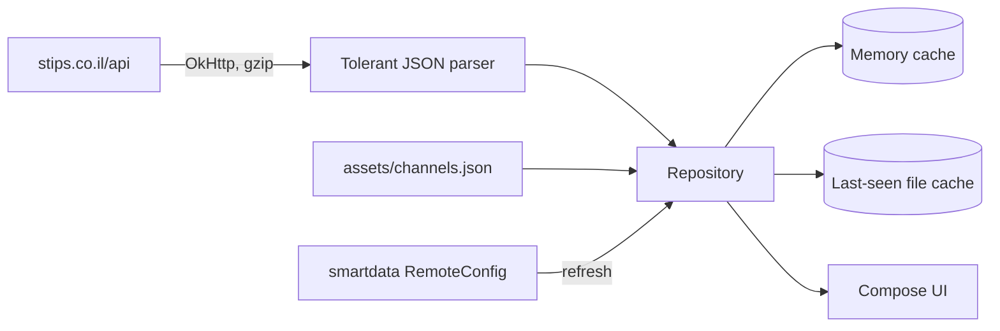

# SPEC-04: Data

*Where the content comes from, what it looks like, and how the app handles it. Everything in §2 was measured against the live service on 2026-11-02; re-check it when something breaks (§5).*

## 1. Source evaluation

| Source | What it gives | Access | Terms | Verdict |
|---|---|---|---|---|
| `https://stips.co.il/api` (the site's own JSON API) | Questions, answers, channels, topics, profiles, notifications, messages | HTTPS. Reads work without an account; writes need a signed-in session cookie | No public API, docs or license. Site terms apply (§6) | **Use.** The only source. It's the same API the website and the official app call |
| Official app `com.stipsapp` | A Cordova wrapper around the same website (`window.plugins.socialsharing` in the web bundle) | Google Play | — | Not a data source. A reference for features and pain points |
| `https://cdn.stips.co.il` | User-uploaded question photos and profile photos (JPEG) | Anonymous HTTPS | Stips and its users | **Use** for artwork and avatars |
| `https://images.unsplash.com` | Stock cover photos that askers pick for their question | Anonymous HTTPS | Unsplash License: free to use; credit the photographer | **Use**, with the photographer's credit on the question screen |
| HTML scraping, search engines | — | — | — | **Not needed.** The site is a single-page app; the API returns clean JSON |

## 2. API reference

### 2.1 Request format

- **One endpoint:** `https://stips.co.il/api`, GET with query parameters:

| Parameter | Value |
|---|---|
| `name` | The call: `objectlist`, `omniobj`, `homepage.content`, `smartdata.get`, `user.login`, … |
| `api_params` | A JSON object, serialized to a string |
| `rest_action` | For `omniobj` only: `GET` · `PUT` · `POST` · `DELETE` |
| `omniobj` | For `omniobj` only: `{"objType":"…","data":{…}}` as a string |

- **The plus-sign quirk:** the server decodes `+` as a space, so the web app replaces every `+` inside the JSON strings with `~MODU_PLUS_SIGN~`. The app must do the same. *Verified:* topic `C++` returns C++ questions only when encoded this way.
- **Writes** (the web app's rule): POST the same fields as a form body when `rest_action` is `PUT`/`POST`, or when the JSON is longer than 200 characters.
- **Session:** a classic ASP cookie (`ASPSESSIONID…`). The web app restores a signed-in session at start-up by calling `user.login` with `auth_token` (kept in the browser's localStorage under a key ending in `UserService.appUser_a_token`).
- **No special headers** are needed. Responses are gzip-compressed JSON, labeled `text/html; Charset=UTF-8`, behind Cloudflare (`cf-cache-status: DYNAMIC`, not cached).

### 2.2 Response envelope

```json
{ "status": "ok", "error_code": "", "error_msg": "", "data": …, "exec_time": "297ms", "sqls": [ … ] }
```

| `error_code` | Meaning |
|---|---|
| `API_ERROR_GENERAL` | Generic failure; `error_msg` is Hebrew text (for example, missing permission) |
| `API_ERROR_EOF` | The item doesn't exist (deleted question) |
| `API_ERROR_BANNED` | The signed-in user is banned |

### 2.3 Calls

**Read calls (no account needed), all verified:**

| Purpose | `name` | `api_params` / `omniobj` | Returns |
|---|---|---|---|
| Newest questions | `objectlist` | `{"method":"ask.new","page":1}` | `data`: array of 30 questions. An empty array means the end |
| Hot questions | `objectlist` | `{"method":"ask.hot","page":1,"filter_section_name":"now"}` (`now` · `today` · `week`) | Same |
| A channel | `objectlist` | `{"method":"ask.new","channel":"לימודים","page":1}`; hot adds `"filter_section_name":"week"` (`week` · `month`) | Same, all from that channel. **The channel is passed by its Hebrew name**, not its id |
| A topic (tag) | `objectlist` | `{"method":"ask.new","topic":"מתמטיקה","page":1}`; hot as for channels | Same |
| Pinned questions | `homepage.content` | — | `data.pinnedItems`: 5 questions |
| One question | `omniobj` | `rest_action=GET`, `omniobj={"objType":"ask","data":{"id":19745077}}` | `data.omniOmniObj`: one question |
| Its answers | `objectlist` | `{"method":"ans.for_item","askid":19745077}` | `data`: all answers at once (no paging) |
| Channels | `smartdata.get` | `{"namespace":"item","unit":"RemoteConfig"}` | `data.results.itemChannels.channels` |

**Not available:** a free-text search over questions. The web app's `search_query` parameter is ignored by `ask.new`/`ask.hot` (it's used only in an admin screen). Topics (tags) are the closest thing.

**Write and account calls (seen in the web bundle, not yet called; verify in the sign-in round):**

| Purpose | `name` | Parameters seen |
|---|---|---|
| Sign in / restore session | `user.login` | `email`, `password`, `auth_token`, `auth_cookie_password` |
| Who am I | `user.get_app_user` | — (fails with `API_ERROR_GENERAL` when signed out) |
| Vote on an answer | `item.vote` | `objType`, `id`, `vote` (1, 0, −1) |
| Give a flower (best answer) | `item.send_flower` | — |
| Post an answer | `omniobj` (create) | `objType:"ans"`, `data:{askid, a, name, anonflg, link1, link1name}` |
| Ask a question | `omniobj` (create) | `objType:"ask"`, `data:{q, text_content, tagslist, photo, anonflg, name, ask_type:11, channel_id}` |
| My questions / answers / pins | `objectlist` | `{"method":"ask.user_activity","for_current_user":true,"filter_section_name":"asked"}` (`asked` · `ansed` · `pinned`) |
| Notifications | `notifications.list` | — |
| Private messages | `messages.list`, `messages.from_user`, `messages.send`, `messages.count` | `page`, `userid`, `msgid` |
| Profile | `profile.page_data` | — |
| Report | `reports.send` | — |

### 2.4 Question (`objType: "ask"`)

| Field | Example | Use |
|---|---|---|
| `data.id` | `19745126` | Identity; links `https://stips.co.il/ask/<id>` |
| `data.q` | "איך התליון שלי?…" | Title (the question itself) |
| `data.text_content` | "https://www.reddit.com/…" | Body, plain text with `\n`; may contain URLs |
| `data.tagslist` | `["כסף","מחירים"]` | Topics |
| `data.time` | `2026/11/02 16:59:56` | Posted time, **Israel local time, no zone** |
| `data.anonflg` | `true` | Asked anonymously (no profile link) |
| `data.photo` | `4791385491` or `unsplash:StifWyrXbdc` | Cover image (§2.6) |
| `data.answer_count`, `data.pin_count` | `13`, `0` | Counts |
| `data.channel_id` | `4` | `0` = no channel |
| `extra.hebrew_time` | "33 שניות" | The server's relative time (Hebrew only; the app formats its own) |
| `extra.url` | `ask/19745126/<slug>` | Share link path |
| `extra.content_image` | `url_small`, `url_medium`, `creator_name`, `creator_username` | Unsplash cover and credit |
| `extra.item_profile` | `nickname`, `userid`, `photostamp`, `online`, `anonflg` | The asker |
| `meta.permissions` | `edit`, `delete`, `report`, … | What the current user may do |

### 2.5 Answer (`objType: "ans"`)

| Field | Use |
|---|---|
| `data.id`, `data.askid` | Identity, parent question |
| `data.a` | Text, plain with `\n` |
| `data.name`, `data.anonflg` | Display name; anonymous answers carry a chosen nickname (for example "אנונימית") |
| `data.time` | Israel local time |
| `data.votes_score`, `data.votes_count` | Score |
| `data.link1…3`, `data.link1name…3name` | Optional links |
| `extra.userVote` | The current user's vote |
| `extra.flowered` | Picked as a best answer (a "flower") |
| `extra.item_profile` | The answerer |

### 2.6 Images

| Image | URL | Measured size |
|---|---|---|
| Question photo, thumbnail | `https://cdn.stips.co.il/photos/s/<photo>.jpg` | 3.6 KB |
| Question photo, 400 px wide | `https://cdn.stips.co.il/photos/w400/<photo>.jpg` | 35 KB |
| Question photo, large | `https://cdn.stips.co.il/photos/z/<photo>.jpg` | — |
| Unsplash cover | `extra.content_image.url_small` (400 px) / `url_medium` (680 px) | ~30–60 KB |
| Profile photo, small / large | `https://cdn.stips.co.il/photos/user_profile/t|l/<userid>/<photostamp>.jpg` | 4 KB / 115 KB |
| Channel icons | SVG on the site | **Not used:** Android can't decode SVG; the app uses its own icons |

A numeric `photo` is a Stips upload; `unsplash:<id>` means the cover is in `content_image`. A question with neither gets a generated monogram (DESIGN-PHILOSOPHY §2.8).

### 2.7 Channels (snapshot 2026-11-02)

| id | Name | Meaning | Site icon | Gradient (site) |
|---|---|---|---|---|
| 1 | מוסיקה | Music | `music` | `#ff5900 → #ffec27` |
| 2 | אינטרנט וטכנולוגיה | Internet and technology | `technology` | `#1697b1 → #00074e` |
| 4 | לימודים | Studies | `dna` | `#00b165 → #26c1f8` |
| 7 | סדרות וסרטים | Series and movies | `movies` | `#af00c9 → #a30606` |
| 8 | בעלי חיים | Animals | `animals` | `#7bd5fd → #3b58e3` |
| 9 | פילוסופיה | Philosophy | `philosophy` | `#800080 → #ea4fc9` |

The snapshot, with every channel's full gradient, ships as `app/src/main/assets/channels.json` (§4). Each channel's first strong color seeds its tinted scheme (DESIGN-PHILOSOPHY §2.2).

### 2.8 Measured costs and speed

| Request | Transfer (gzip) | Raw | Time |
|---|---|---|---|
| Feed page (30 questions) | 9.5 KB | 45 KB | 0.4–0.55 s |
| Answers (13) | 1.6 KB | 9.4 KB | 0.2 s |
| Channels config | < 1 KB | 1.4 KB | 0.1 s |

Browsing 100 questions with thumbnails costs roughly 0.5–1 MB; opening questions with large covers adds about 50 KB each.

## 3. Data model (in the app)

```kotlin
data class Question(
    val id: Long, val title: String, val body: String, val topics: List<String>,
    val postedAt: Instant, val answerCount: Int, val pinCount: Int, val channelId: Int,
    val author: Author, val cover: Cover?, val sharePath: String,
)
data class Answer(
    val id: Long, val questionId: Long, val text: String, val postedAt: Instant,
    val score: Int, val flowered: Boolean, val author: Author, val links: List<Link>,
)
data class Author(val nickname: String, val userId: Long?, val photoStamp: String?, val anonymous: Boolean, val online: Boolean)
sealed interface Cover { data class Stips(val photoId: String) : Cover; data class Unsplash(val small: String, val medium: String, val credit: String) : Cover }
data class Channel(val id: Int, val name: String, val icon: String, val colors: List<Color>)
enum class Feed { New, Hot }   // with HotWindow: Now, Today, Week, Month
```

- **The parser is tolerant:** a missing or mistyped field gets a safe default instead of failing the whole list. Ids may arrive as numbers or strings.
- **Times** are parsed as `Asia/Jerusalem` local time and shown relative in the user's language ("5 min", "לפני 5 דק׳").

## 4. Pipeline



- **Bundled snapshot:** `channels.json` makes the Channels screen instant and offline-ready. Unit tests validate it (ids unique, names non-empty, colors parse).
- **Cache what you've shown:** the last feed page of each list is saved to the app's private files, so the next launch shows it at once and refreshes quietly.
- **Updatable without a release:** at start-up the app refreshes channels from `smartdata.get` and keeps the snapshot as a fallback.

## 5. Automation and maintenance

- No server of our own, no background polling in v0.x.
- **When the site changes** (renamed calls, new fields): the parser tests (with recorded fixtures in `app/src/test/resources/`) show what still parses. Re-run the probes in MAINTAINING.md to compare.
- **Fixtures** are trimmed real responses with personal data replaced (nicknames → "משתמש/ת", user ids → 1000+).

## 6. Governance and legal

**Stips' terms of use** ([stips.co.il/about/terms](https://stips.co.il/about/terms), read 2026-11-02; the page renders only in a browser):

| Clause | Text (Hebrew) | Meaning for us |
|---|---|---|
| Operator | "האתר מנוהל ומופעל על-ידי נדב דפני - אינטרנט ותוכנה בע\"מ" | Who to ask (Google Play lists the developer as Futurebit Media Ltd., `contact@stips.co.il`) |
| Intellectual property | "אין להעתיק, לשכפל, להפיץ, למכור, לשווק ולתרגם מידע כלשהו לרבות סימני מסחר, תמונות, צילומים, טקסטים וקוד מחשב מן האתר בלא קבלת רשותה המפורשת של הנהלת האתר מראש ובכתב." | Copying or distributing content or trademarks needs **prior written permission** → private until Stips agrees (D-02) |
| Commercial use | "אין לעשות כל שימוש מסחרי במידע, בתכנים ובנתונים המתפרסמים באתר… בלא קבלת הסכמתה של הנהלת האתר מראש ובכתב." | The app is free, with no ads or payments |
| Automated access | "חל איסור חמור להפעיל כל יישום מחשב… לרבות תוכנות מסוג Crawlers, Robots וכדומה, שנועדו לשם חיפוש סריקה, העתקה או אחזור באופן אוטומטי של מידע ותכנים מהאתר לשם יצירת העתק, מלא או חלקי…" | No crawling, mirroring, bulk prefetch or export. The app fetches only what the user opens, like a browser (D-13) |
| User content | Users grant Stips a free, worldwide, perpetual license to what they post | Answers posted through the app are ordinary Stips posts |
| Law | Israeli law; courts in Jerusalem and Tel Aviv | — |

**Other sources:**
- `robots.txt` allows everything except one profile page.
- Unsplash photos: free under the Unsplash License; the app shows the photographer's name (from `content_image.creator_name`).
- Prior art: open-source wrappers of the same API exist (for example `stipspy`, Chrome extensions such as StipsX under Apache-2.0); none is endorsed by Stips. We don't reuse their code.

**Our rules:**
- No Stips logo or artwork in the repo; the icon is our own.
- Show only what the site shows. Profile fields the website hides (some tools expose birth dates and gender) are never displayed.
- Disclaimer in About and on the sign-in screen: "An independent app, not affiliated with Stips."
- If Stips asks us to stop or blocks the app, we stop; we don't work around it.
